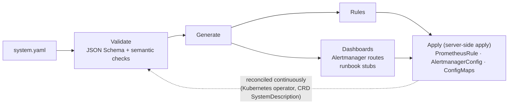

# Kamerton

Website and documentation: [kamerton-labs.github.io](https://kamerton-labs.github.io/)

Kamerton is an orchestrator that sits **on top of** existing open-source
observability programs and manages them: OpenTelemetry Collector, Prometheus,
Alertmanager, Grafana, Loki and Tempo, running in Kubernetes and installed with
Helm. It does not replace or fork any of them.

You write one short YAML *system description*: which services exist, their type
(http / grpc / queue / database), thresholds and SLOs, which are critical, and
where alerts go (Telegram, email). Kamerton turns it into Prometheus alert
rules, Grafana dashboards, Alertmanager routes and runbook stubs, applies them,
and keeps reconciling the description against what is actually configured.

> **Status: 0.2.3, early.** The chart runs on a single-node k3s cluster next
> to the OpenTelemetry Demo, and the rule library catches the demo's fault
> scenarios there. See [status and limitations](#status-and-limitations)
> before you rely on it. The web UI and notifications are in English, with
> Russian as a second language.

## How it works



The generated rules cover error rate, latency, saturation, queue lag, SLO burn
rate, requests stopped, slower or CPU far above normal, memory or CPU near the
limit, OOMKilled, and a queue that nobody reads.

- **Triage**: when an alert fires, Kamerton walks the `dependsOn` graph to find
  the probable source and shows the chain of affected services. Alerts of
  services that call a failing dependency are muted, so one message arrives
  per incident, followed by a short message with what changed and where it
  fails (see [Incidents](#incidents)).
- **Discovery**: lists services that already send telemetry (from span metrics
  in Prometheus) so you can add them to the description.
- **Backtest**: shows how many times a proposed rule would have fired over the
  history stored in Prometheus.

One binary serves the API and the web UI (React, embedded with `go:embed`).
Details: [docs/ARCHITECTURE.md](docs/ARCHITECTURE.md).

## Quick start

### Prerequisites

- A Kubernetes cluster ≥ 1.27 (tested on single-node k3s) and `kubectl`.
- Helm (the chart is apiVersion v2; verified with Helm 4.3).
- A clone of this repository: the Helm chart is installed from the clone (no
  chart repository is published yet).

### 1. Get the chart

```sh
git clone https://github.com/kamerton-labs/kamerton.git
cd kamerton
```

The container image is published for linux/amd64 and linux/arm64 as
`ghcr.io/kamerton-labs/kamerton`; the chart uses the tag that matches its
version. To run your own build instead, see
[Building the image](#building-the-image).

### 2. Install with Helm

```sh
helm install kamerton ./deploy/helm/kamerton \
  --namespace kamerton --create-namespace --dependency-update \
  --set externalURL=http://localhost:8080
```

This installs the Kamerton core (Deployment, Service, RBAC, CRD) plus the
managed programs as pinned chart dependencies: kube-prometheus-stack
(Prometheus Operator, Prometheus, Alertmanager), Grafana, Loki, Tempo and the
OpenTelemetry Collector. `--dependency-update` downloads those charts; no
`helm repo add` is needed for it. All settings are documented in
[values.yaml](deploy/helm/kamerton/values.yaml).

`externalURL` is the address people use to open the UI; notification links
point there. Without it notifications carry no links (in-cluster addresses do
not open from a phone).

### 3. Open the UI

```sh
kubectl -n kamerton port-forward svc/kamerton 8080
# then open http://localhost:8080
```

### 4. Set a login

Out of the box the UI and API are open to anyone who can reach them (the
Channels screen shows a red notice). Turn on the login before you expose the
UI beyond a port-forward:

```sh
kubectl -n kamerton create secret generic kamerton-auth \
  --from-literal=username=admin --from-literal=password='<strong password>'
helm upgrade kamerton ./deploy/helm/kamerton -n kamerton --reset-then-reuse-values \
  --set auth.existingSecret=kamerton-auth
```

Details and limits: [Login](#login).

### 5. Describe a system

In the UI press "Add system", then add services on the
canvas: services that already send telemetry are offered for one-click adding.
Or apply a description file:

```sh
kubectl -n kamerton apply -f https://raw.githubusercontent.com/kamerton-labs/examples/main/otel-demo/system.yaml
kubectl -n kamerton get systemdescriptions
```

Descriptions that send notifications must live in Kamerton's namespace (an
AlertmanagerConfig can only reference Secrets in its own namespace). Then
connect Telegram or email under "Channels", see
[Telegram](#telegram-from-the-ui) and [Email](#email-from-the-ui).

### 6. Connect programs you already run

The page "Kamerton status" shows the Prometheus,
Alertmanager, Grafana, Loki, Tempo and Collector that Kamerton uses. Each
address can be changed there and is checked before saving; "Find
installed" lists programs already running in the
cluster. See [Sets of programs](#sets-of-programs).

To skip the bundled Prometheus and use your own from the start:

```sh
helm install kamerton ./deploy/helm/kamerton -n kamerton --create-namespace --dependency-update \
  --set kube-prometheus-stack.enabled=false \
  --set bringYourOwn.prometheus.enabled=true \
  --set bringYourOwn.prometheus.url=http://prometheus-operated.monitoring:9090 \
  --set bringYourOwn.prometheus.alertmanagerUrl=http://alertmanager-operated.monitoring:9093
```

Your cluster must run the **Prometheus Operator**: Kamerton delivers rules and
routes as PrometheusRule and AlertmanagerConfig objects and does not push to
Prometheus' or Grafana's HTTP APIs. The bundled Collector and Grafana are
pre-wired to the bundled Prometheus (`opentelemetry-collector.config.exporters.prometheusremotewrite.endpoint`,
`grafana.datasources`): point them at yours or disable them
(`opentelemetry-collector.enabled=false`, `grafana.enabled=false`).
`bringYourOwn.grafana` works the same way for Grafana. A Collector of your
own needs the spanmetrics connector with `namespace: traces.span.metrics`
(or matching `spec.telemetry` names) and `metrics_expiration` (see
[Rules that need no threshold](#rules-that-need-no-threshold)).

### Try it with the OpenTelemetry Demo

[kamerton-labs/examples](https://github.com/kamerton-labs/examples/tree/main/otel-demo) holds the setup used for testing:
`values-kamerton.yaml` (Kamerton settings for a small cluster),
`values-demo.yaml` (the demo with its own backends off, sending everything to
Kamerton's Collector) and `system.yaml` (a description of the demo's
services). The commands are in the comments at the top of each file. Replace
the placeholder chat ID and addresses in `system.yaml`, or set receivers up
from the UI.

## A description

```yaml
apiVersion: kamerton.dev/v1alpha1
kind: SystemDescription
metadata:
  name: shop
spec:
  defaults:
    namespace: shop
    rateWindow: 5m
    excludeOperations: ['flagd\.evaluation\.v2\.Service/EventStream']
    errorRate: {threshold: 0.05, minRequestsPerSecond: 0.05}
  services:
    - name: checkout
      type: grpc
      critical: true
      dependsOn: [payment]
      errorRate: {perOperation: true}
      slo: {objective: 99.5}
    - name: payment
      type: grpc
      critical: true
  notifications:
    receivers:
      - name: oncall
        telegram:
          chatID: -1001234567890
          botTokenSecret: {name: kamerton-telegram, key: bot-token}
    routing:
      critical: [oncall]
```

A complete example for the OpenTelemetry Demo is in
[kamerton-labs/examples](https://github.com/kamerton-labs/examples/blob/main/otel-demo/system.yaml). Metric and
label names are configurable in `spec.telemetry`; nothing is tied to the demo.

Get the JSON Schema for your editor with `kamerton schema > systemdescription.schema.json`.

### Rules that need no threshold

Some failures look fine to fixed thresholds: one rare operation failing
while the service as a whole stays under 5%, a cache that stops working and
takes responses from 7 to 300 ms, a CPU spike in a pod without a CPU limit, a
container killed for running out of memory once. These rules are on by
default:

| Rule (alert) | Fires when |
| --- | --- |
| Errors per operation (`KamertonOperationErrorRateHigh`) | an operation's error share is above the threshold with at least 3 failed calls in the window; `errorRate.perOperation: false` turns it off |
| Latency per operation (`KamertonOperationLatencyHigh`) | an operation's quantile is above the threshold (at least 3 calls), for operations that were under it during the previous hour; pending 30s; `latency.perOperation: false` |
| Slower than normal (`KamertonLatencyAboveNormal`) | the service quantile is 5× its value over the previous hour (ending 10 min ago) and above 100 ms; pending 1m; `latency.aboveNormalFactor` (0 = off) |
| Memory near the limit (`KamertonMemoryNearLimit`) | no `saturation.memory`: memory above 95% of the pod limit and the 1h trend reaches the limit within 30 min; `saturation.memoryLimitShare` |
| CPU near the limit (`KamertonCPUNearLimit`) | no `saturation.cpuCores`: CPU above 90% of the pod CPU limit; `saturation.cpuLimitShare` |
| CPU far above normal (`KamertonCPUAboveNormal`) | no `saturation.cpuCores`: above 0.5 cores and 3× the previous hour; `saturation.cpuAboveNormalFactor` |
| Out of memory (`KamertonOOMKilled`) | the last termination was OOMKilled and the container restarted in the last 10 min; fires at once; `saturation.oomKilledEnabled: false` |
| No ready pods (`KamertonNoReadyPods`) | pods of the service (found by `workload`) exist and none is ready, or the last one is gone (then only within an hour of the last ready pod: a deliberate scale to zero cannot be told from a failure); pending 30s; a cause for the grouping below; `noReadyPods.enabled: false`, `noReadyPods.for`; metric `telemetry.containers.readyMetric` (kube-state-metrics `kube_pod_status_ready`) |
| No data from the service (`KamertonServiceTelemetryMissing`) | http/grpc services: the service normally has traffic at this hour (see below), sent span metrics in the last day, none for 3 min, and other services of the system still send; silent while its "requests stopped" rule covers the stop; pending 1m; severity of its "requests stopped" rule where that is on, else warning; `noData.enabled`, `noData.after`, `noData.severity`; the traffic floor is `trafficDrop.minRequestsPerSecond` |
| Kamerton cannot see the system (`KamertonTelemetryMissing`) | the system normally has traffic at this hour, and none of its services has sent span metrics for 3 min although some did in the last day (Collector, remote write or Prometheus broken); pending 1m, critical; the message says that no other alert can fire until data returns; mutes the per-service "no data" alerts; `spec.noData.enabled`, `spec.noData.after`; floor `defaults.trafficDrop.minRequestsPerSecond` |
| Nobody reads the queue (`KamertonQueueConsumerStopped`) | services with `queue`: a consumer group of the topic has had no members for 1 min, or its lag stayed above 0 for 3 min while its committed offset did not move; pending 1m; same severity as the lag rule; `queue.consumerStoppedEnabled: false`; metrics `telemetry.queues.membersMetric` / `offsetMetric` |

The service latency rule needs at least 3 calls in the window instead of a
default minimum rate, so a rare operation (two orders a minute) is checked.
Rules with a "normal" stay silent without enough history (a new service, the
first hour after a gap in the data).

Every other rule is an expression over span metrics, and with no samples it
returns nothing: if the Collector stops writing to Prometheus, those rules go
quiet. The two "no data" rules catch that, and they never page for what never
sent data: a service counts only if it sent span metrics for about a quarter
of an hour within the last day. A service gone for a day (renamed, removed)
stops alerting by itself. With 3 minutes and the 1-minute pending period,
the person on call hears about missing data about 5 minutes after the last
sample. If Prometheus loses its storage, "before" is lost with it and the
rules arm again once data arrives.

In span metrics "idle" and "broken" look the same, so a service (or system)
is expected to have traffic now only if, in the two hours around this time a
week ago, it had calls in every 10 minutes, averaging above
`trafficDrop.minRequestsPerSecond` (default 0.02/s). In its first week, when
it has no data from a week ago, yesterday decides. An idle test cluster at
night, a batch service or an internal tool on a weekend therefore never
reports missing data, and nothing fires in the first day of a new service.
The price: a day-time service is not reported for the hour after its usual
start and the hour before its usual end, and an alert about a service that
stays down resolves an hour before its usual end of day (it fires again the
next morning). "Requests stopped arriving" counts no calls at all under the
same condition. It keeps firing when the series vanish, and the per-service
"no data" alert stays silent while it does: a critical service that stops
completely gets one notification, about 4 minutes after its last call. "No
data" speaks for services without that rule, and when fewer than half of the
system's services send (part of the pipeline is down).

The per-service "no data" rule needs the series of a silent service to
disappear. The spanmetrics connector keeps exporting them as flat counters
forever unless `metrics_expiration` is set; the bundled Collector sets
`metrics_expiration: 2m`. **If you bring your own Collector, set it too**,
or `KamertonServiceTelemetryMissing` can never fire. With it, a service is
reported about 6 minutes after its last span (2 minutes of expiration, the
3-minute window, 1 minute pending). If Prometheus keeps less than about a
day of data, nothing is ever expected and neither "no data" alert, nor the
complete-stop case of "requests stopped", can fire.

## Services without OpenTelemetry

Almost every rule reads span metrics, which the Collector derives from
traces. A service that sends no traces gets little from Kamerton. The chart
can install [OpenTelemetry eBPF Instrumentation](https://opentelemetry.io/docs/zero-code/obi/)
(OBI, Apache-2.0, formerly Grafana Beyla) for such services. It is off by
default:

```sh
helm upgrade kamerton ./deploy/helm/kamerton -n kamerton --reset-then-reuse-values \
  --set autoInstrument.enabled=true
```

**What it is.** A DaemonSet (`kamerton-auto-instrument`, OBI v1.0.0) that
attaches eBPF probes in the kernel and in the processes on its node, without
code changes or restarts. It sends the calls it sees as OTLP traces to
Kamerton's Collector. The Collector turns them into the same series as SDK
traces (`traces_span_metrics_calls_total`, `..._duration_milliseconds_bucket`
with `service_name`, `span_name`, `span_kind`, `status_code`), so the
rules, the dashboards and "found in telemetry" work unchanged.

**What it needs.** Linux 5.8+ with BTF (`ls /sys/kernel/btf/vmlinux`), amd64
or arm64. By default the pod on every node is a **privileged container with
`hostPID: true`** (all capabilities, host devices, no AppArmor or seccomp
confinement), not on the host network and without host paths. Its namespace
must allow such pods (Pod Security level `privileged`). It reads pods,
services, nodes and ReplicaSets in all namespaces.

Tried on single-node k3s (colima, Ubuntu kernel 6.8.0 aarch64, BTF present,
`kernel.perf_event_paranoid=4`, AppArmor on): with only the capabilities
OBI's documentation lists (`BPF`, `PERFMON`, `SYS_PTRACE`,
`DAC_READ_SEARCH`, `CHECKPOINT_RESTORE`, `NET_RAW`) the agent attached its
probes but could not enter the pods' network namespaces (`join target netns:
operation not permitted`) and recorded nothing. Privileged, it worked.
Entering a network namespace (`setns`) needs `CAP_SYS_ADMIN` (setns(2), and
OBI's `pkg/internal/netns`), so
`opentelemetry-ebpf-instrumentation.privileged=false` runs as UID 0 with
hostPID, those six capabilities plus `SYS_ADMIN`
(`opentelemetry-ebpf-instrumentation.extraCapabilities`) and a read-only root
filesystem. That mode follows from the documentation and source and has not
been tried on a cluster yet; `SYS_ADMIN` is close to root anyway.

Memory grows with the number of processes it observes: about 900Mi on one
node with 26 OpenTelemetry Demo pods; 1Gi was OOMKilled. Default request
512Mi, limit 2Gi, CPU request 100m. Narrow `autoInstrument.namespaces.include`
to use less. The log line `creating or accessing OTEL namespace in bpffs
failed` followed by `OBI will use process-internal maps` is harmless.

**What it sees.** HTTP/1, HTTP/2, gRPC, also Kafka, NATS, MQTT, Redis,
Memcached, PostgreSQL, MySQL and others, in Go, Java, .NET, Python, Ruby,
Node.js, Rust and C/C++ programs. TLS is seen in Go programs and in programs
that use OpenSSL, without decrypting traffic. By default it observes every
namespace except `kube-system` and Kamerton's own
(`autoInstrument.namespaces.include` / `exclude`); a pod annotated
`kamerton.dev/auto-instrument: "false"` is left out.

**What it cannot see.** Business operations inside a process, custom
attributes, encrypted traffic of runtimes it has no hook for, and the method
of a gRPC connection opened before the agent started (span name `grpc` until
the client reconnects: restart those workloads once). A request that gets no
response at all (timeout, reset) is not counted as an error.

**Differences from SDK span metrics**, all handled without changing the rules:

- Service name: `OTEL_SERVICE_NAME` / `OTEL_RESOURCE_ATTRIBUTES` of the
  process if set, else the pod annotation
  `resource.opentelemetry.io/service.name`, else the label
  `app.kubernetes.io/name`, else the Deployment (StatefulSet, DaemonSet, ...)
  name. "Found in telemetry" shows that name. If it differs from the name in
  your description, set `telemetryName` on the service, or put the annotation
  on the pod template.
- Span names: gRPC is `package.Service/Method`, as with SDKs. HTTP is
  `METHOD /path` where numbers and IDs become `*` (`GET /orders/*`), while
  SDKs usually report the route template (`GET /orders/{id}`). Operation
  names in a description (`operations`, `excludeOperations`) must
  use the agent's form, or set `autoInstrument.httpRoutes.patterns` to the
  templates. Requests to `/metrics`, `/healthz`, `/readyz` and `/livez` are
  not recorded (`autoInstrument.httpRoutes.ignored`).
- Status: server spans are errors on HTTP 5xx and on the gRPC codes the
  OpenTelemetry conventions list (UNKNOWN, DEADLINE_EXCEEDED, UNIMPLEMENTED,
  INTERNAL, UNAVAILABLE, DATA_LOSS), the same as SDKs.
- Duration starts when the request reaches the socket, so it can be slightly
  longer than the SDK's.

**Start with an include list.** Observing every namespace also instruments
programs nobody would describe. On the test cluster a second Prometheus
showed up as a service; databases (`astronomy-db`, `valkey-cart`) did too,
which is useful. Monitoring programs (Prometheus, Alertmanager, Grafana,
Loki, Tempo, Collectors, kube-state-metrics, node-exporter and similar) and
browsers such as a load generator's headless Chromium are now excluded by
executable (`autoInstrument.excludeExecutables`). On a real cluster set
`autoInstrument.namespaces.include` to the namespaces of the services that
have no SDK.

**Counted twice.** Services that already send OpenTelemetry should be left
out (`autoInstrument.skipSDKInstrumented`, on): pods injected by the
OpenTelemetry Operator, and processes the agent has seen making a successful
OTLP export. That second check reacts to traffic and
[misses some SDKs](https://github.com/open-telemetry/opentelemetry-ebpf-instrumentation/blob/v1.0.0/devdocs/exclude-otel-instrumented-services.md),
mainly those that send every signal over one gRPC connection whose method
the agent cannot decode. On the test cluster, server call rates with the
agent on against an hour before, under slightly lower load:

| Service (SDK) | With agent | Before |
| --- | --- | --- |
| image-provider (nginx, OTel module) | 12.9/s | 4.4/s |
| currency (C++) | 1.78/s | 1.18/s |
| recommendation (Python, grpcio) | 1.68/s | 0.98/s |

Go, Java, .NET and Node.js services were not counted twice. OBI's capture
rules cannot match environment variables or loaded libraries, and excluding
by language would also drop the uninstrumented services of that language, so
there is no better default. Doubling leaves error ratios and latency
quantiles mostly as they are (both sources count the same calls), but
request rates are too high, and "requests stopped" and "far below normal"
compare against a normal that changes when the agent is turned on or off.
Find the services the agent reports (`job` is
`<service.namespace>/<service.name>`); one that also has its own SDK is
counted twice:

```promql
count by (job) (target_info{telemetry_distro_name="opentelemetry-ebpf-instrumentation"})
```

Leave such pods out with the annotation `kamerton.dev/auto-instrument:
"false"` on the pod template, for example:

```sh
kubectl -n shop patch deployment currency --type merge \
  -p '{"spec":{"template":{"metadata":{"annotations":{"kamerton.dev/auto-instrument":"false"}}}}}'
```

Settings are read when the agent starts: after changing `autoInstrument`
values run `kubectl -n kamerton rollout restart daemonset/kamerton-auto-instrument`.

## Configuration

### Sets of programs

The addresses given at install time form the built-in set of programs
("Main"). On the status page ("Kamerton status") each address can be
changed, checked before saving («works / does not answer / this is not
Prometheus») and reset to the install-time value. "Find installed"
asks the Kubernetes API for Services in all namespaces and Prometheus
Operator resources (read-only; `stacks.discovery.enabled`), confirms each
candidate with an HTTP check and lets you put a found program into a set.
A company with several Prometheus instances adds more sets (for example one
per team) and picks a set per system (`spec.stack`, or in the system's
panel on the canvas). Everything that reads Prometheus or Alertmanager for
a system uses its set; the set's extra labels go on the system's
PrometheusRule / AlertmanagerConfig so that the right Prometheus Operator
instance picks them up (filled from the operator's selectors when found).
Sets live in the ConfigMap `kamerton-stacks` (nothing secret).
[kamerton-labs/examples](https://github.com/kamerton-labs/examples/tree/main/second-prometheus) adds
a second Prometheus to try this on one cluster.

### Secrets

Secrets never go into the description or the values file. The Telegram bot
token and the SMTP password are entered in the UI and stored in Secrets in
Kamerton's namespace, or you create those Secrets yourself:

```sh
kubectl -n kamerton create secret generic kamerton-telegram --from-literal=bot-token=<token>
kubectl -n kamerton create secret generic kamerton-smtp --from-literal=password=<password>
```

The current `externalURL` is shown in the UI under "Kamerton status".

### Telegram from the UI

Open **Channels** in the menu:

1. Create a bot with [@BotFather](https://t.me/BotFather) (`/newbot`) and paste
   the token. The core checks it with `getMe` and stores it in the Secret
   `kamerton-telegram` (key `bot-token`) in Kamerton's namespace. The token is
   never written to the description, logs or API responses; the UI only shows
   the bot's name. An existing Secret with that name keeps working.
2. Add the bot to your groups. The core long-polls `getUpdates` (leader
   replica only) and lists the chats within seconds; chats the bot is removed
   from are marked unavailable; a group upgraded to a supergroup is followed
   to its new ID, including receivers in the description.
3. Send a test message per chat, choose severities (and optionally services)
   per chat, and save: receivers and routes are written into the
   SystemDescription and the controller regenerates the AlertmanagerConfig.
   What each system sends to which chat is chosen inside the system (canvas,
   "Where to send alerts"); chats are shared by all systems.

Limits: Telegram keeps updates for 24 hours and has no "list my chats" call,
so a chat the bot joined long before Kamerton started polling does not
appear by itself: check it by ID in the same screen, or re-add the bot. A bot
may have only one `getUpdates` consumer and no webhook; use a dedicated bot
for Kamerton.

### Email from the UI

On the same **Channels** page:

1. Connect the mail server: SMTP `host:port` (hints for Yandex, Mail.ru and
   Gmail), sender address, login and password. The core logs in to the server
   to check the settings, then stores the password in the Secret
   `kamerton-smtp` (key `password`) in Kamerton's namespace; the server,
   sender and login are kept in the ConfigMap `kamerton-email-state`. The
   password is never written to the description, logs or API responses.
2. Add recipients: a name and one or more addresses ("On-call": two
   addresses). Send a test email to check delivery.
3. In a system, "Where to send alerts" → "Add receiver" offers
   Telegram chats and email recipients; the receiver is written in the usual
   `notifications.receivers[].email` shape (`to`, `from`, `smarthost`,
   `authUsername`, `authPasswordSecret`). Changing the server or a
   recipient's addresses later updates every system that uses it.

Receivers written by hand in YAML keep working and are left untouched.

Without the login turned on, anyone who can open the UI can replace or delete
the bot token, change receivers and send messages as the bot (no endpoint
returns the token or the password).

### Notification text

Notification text is English by default (`spec.notifications.language: ru`
for Russian): firing/resolved, severity, system and service, what is wrong in
plain words with the current value and threshold, since when, and a compact
list for grouped alerts. Times are in UTC unless `spec.notifications.timeZone`
names an IANA zone (for example `Asia/Almaty`), shown with the offset:
"09:18 16.11 UTC+5"; it is also set on the canvas under "Where to send
alerts".

### Incidents

When `payment` goes down, `checkout`, `frontend` and everything above it
start failing too. Kamerton knows the `dependsOn` graph, so:

- **One message per incident.** The generated AlertmanagerConfig has inhibit
  rules: while a service has an error, latency, "requests stopped" or "no
  ready pods" alert, the error, latency, "requests stopped" and SLO
  burn-rate alerts of the services that call it directly are muted (a muted
  alert still mutes its own callers, so whole chains collapse to the cause).
  "No ready pods" fires within about a minute, so with a service scaled to
  zero the cause arrives first. SLO alerts are only muted, never mute: a
  burning budget says nothing about the services a caller depends on.
  Memory, CPU, restart, out-of-memory, queue, "no data" and custom alerts are
  never muted by this (starved ones are, below). A warning mutes only warnings; services in a dependency cycle
  do not mute each other. Turn it off with
  `spec.notifications.groupByCause: false`. The system "no data" alert mutes
  the per-service ones either way.
- **Starved services stay quiet.** A failure also takes traffic away from
  what the failing service calls, or feeds through a queue: with `payment`
  down, `checkout` places no orders, so `email` gets no calls and the
  consumers of `orders` get no messages. Their "no data" and "requests
  stopped" alerts then get the label `kamerton_starved="true"` and are muted
  while a feeder's alert fires, and they join the incident as affected
  services. That happens only when the service has no error, latency or
  "no ready pods" alert of its own, and only when the feeder's failure is
  not the service's doing: a caller with errors explains a silent callee
  only while another dependency explains those errors (or the caller has no
  ready pods, no data or no requests of its own). So a service that is
  unreachable, whose callers fail because of it, is still the cause. For a
  queue, a consumer is a service that depends on the queue and is named in
  its `queue.consumerGroups`; the other services that depend on it produce.
  The alerts API lists muted alerts and
  incidents (cause, "also affected" and the evidence of the follow-up).
- **A follow-up with evidence.** Alertmanager still sends the alert straight
  to Telegram and email, so it arrives while Kamerton is down. It also calls
  Kamerton's webhook, and about 45 seconds later (time for the alerts of the
  callers to fire, so "also affected" is filled) Kamerton sends one short
  message to the same chats and addresses, for example:

  ```text
  🔎 Probable cause · shop (prod)
  checkout: probable cause is payment (payment: Requests stopped arriving since 09:18 UTC+5).
  Also affected: frontend, frontend-proxy.
  What changed in payment in the last 30 min: new version at 09:14 UTC+5 (v1.4.2 -> v1.4.3); container payment restarted 3 times (OOMKilled, exit code 137).
  Most errors: operation oteldemo.PaymentService/Charge (42 failed calls in 30 min).
  Log: "card declined: upstream timeout"
  ```

  When the alerting service has no failing dependency yet (its alert came
  first), Kamerton looks at its direct dependencies at that moment: alerts
  Prometheus reports as pending, no ready pods, error rate or calls far below
  normal by the same queries as the rules. What it sees is named as the
  likely cause ("Likely cause: payment, called by checkout (observed now: No
  ready pods). Its own alerts have not fired yet."). When the cause's own
  alert fires later, its follow-up says that it explains the earlier alert
  ("This explains the earlier alert about checkout").

  Each part appears only when found: the workload changes come from the
  Kubernetes API (pods, ReplicaSets, StatefulSets, Warning events and
  scaling events of the service's `workload`: "payment scaled from 1 to 0
  replicas at 16:50 UTC; no pods exist"), the operation from the span
  metrics in the system's Prometheus, the log line from its Loki, and a link
  to failing traces needs `incidents.grafanaExternalURL`. When nothing useful
  is found yet, Kamerton looks again about 1 and 3 minutes later and on
  later notifications of the incident, then gives up and logs why at Info
  (`follow-up not sent`). One incident gets one follow-up (Alertmanager's
  repeats send nothing new; incidents are kept for a day in the ConfigMap
  `kamerton-followup-state`, so a restart or another replica does not send
  them again). The alerts API returns the last evidence of each
  incident as `evidence`. The follow-up goes only through Kamerton's own
  bot and mail server, only for descriptions in Kamerton's namespace, and
  only in a cluster. Turn it off per system with
  `spec.notifications.evidenceFollowUp: false`, or for the installation with
  `--set incidents.followUp.enabled=false` (no webhook in the routing at
  all; `incidents.followUp.workloadRead=false` keeps the follow-up but
  drops the cluster-wide read access).

- **What helped last time.** Kamerton keeps a history of incidents: system,
  root services and alerts, affected services, start, end, duration and the
  evidence of the follow-up (the current incident is listed too, as open).
  People add two short notes to each: the cause (at most 200 characters)
  and what helped (at most 500), in the UI or in Telegram. When an incident
  with a Telegram follow-up ends after lasting at least 2 minutes, the same
  chats get one short message:

  ```text
  ✅ Incident over · shop: payment (No ready pods), lasted 12 min.
  What helped? Reply to this message, and Kamerton will remind you the next time.
  ```

  A reply to that message becomes the "what helped" note (Kamerton puts 👍
  on it; a later reply replaces it); replies count only from chats that get
  the system's alerts through Kamerton's bot. Email gets no such message,
  because a reply to an email does not come back to Kamerton: write the
  note in the UI. Turn the message off with
  `spec.notifications.askWhatHelped: false`. When the same root service
  fails again (preferably with the same kind of alert), the follow-up
  reminds of the last time, and a note alone is reason enough to send it:

  ```text
  🕘 Happened before: 14:02 27.10 UTC+5, lasted 1 h 12 min.
  Cause: payment pods OOMKilled after a release
  What helped: rolled back to v1.4.2 and raised the memory limit
  Times in the last 30 days: 4.
  ```

  After an outage, callers' error and SLO burn alerts may fire for a while
  (an SLO burn alert clears only when its window no longer holds the
  errors). For 35 minutes after the cause resolved they count as the
  incident's aftermath: no new incident, no second follow-up; the message
  above adds "Still firing after it: checkout (SLO error budget is
  burning)". If they still fire after that, they become an incident of
  their own with a follow-up. A failure of the service's own (no ready
  pods, restarts) is never aftermath.
  The alerts API shows the same as `previous` on each incident, and the
  runbook page of a service lists the last notes about it. At most 300
  incidents of the last 180 days are kept, in the ConfigMap
  `kamerton-incident-history` (in memory without a cluster), with no names
  of people.

Grouping needs the Prometheus Operator to leave Kamerton's matchers alone
(`alertmanagerConfigMatcherStrategy: None`, set by the bundled chart):
span-metric alerts carry no `namespace` label.

### Quieter rules

A rule that fires forty times a week and clears by itself each time teaches
people to ignore it. Kamerton counts this from the alert history in the
system's Prometheus (`ALERTS`, `ALERTS_FOR_STATE`) and, for such a rule,
suggests a change; nothing is changed until someone applies it.

- **How often and how long.** For each rule over the last 1, 3 or 7 days:
  how many times it fired, how many firings cleared within 5 minutes
  ("short"), the longest firing and when it last fired.
- **Consequences are not noise.** When `payment` is down, the error alerts
  of `checkout` and `frontend` fire too, and Alertmanager mutes them by the
  dependency grouping. Kamerton replays that muting on the history: such
  firings (and per-service "no data" during the system-wide one) are
  counted as `consequences` and take no part in what follows.
- **Noisy.** Without verdicts: at least 10 firings in the window and at
  least 3 a day on average, with three quarters of them short. A few short
  real outages on a bad day are not noise; a rule flapping tens of times a
  week is. Or at least 2 people said "noise" and they outnumber "useful";
  the same number of "useful" outnumbering "noise" makes a rule not noisy
  whatever its history.
- **A suggestion.** For a noisy rule with a threshold or a pending period
  (`for`), Kamerton runs the backtest with a few changes: first a threshold
  at most 1.5 times higher (it adds no delay), then a longer `for` (1m, 2m,
  3m, 5m, 10m; at most 3m for a critical rule, so it still pages within
  about five minutes), then a threshold 2 or 3 times higher (lower for a
  custom "less than" rule). It suggests the first change that would have
  removed at least 80% of the short firings and still caught every firing
  that lasted 10 minutes or more. A change that would never have fired is
  offered only for a rule that fired at least 20 times; otherwise it just
  switches the rule off. A longer `for` comes with its cost
  (`delaySeconds`: how much later a real failure would be reported). The
  value is written as the description field takes it
  (`errorRate.threshold: 0.063`, `latency.for: 3m`,
  `saturation.memory: 768Mi`), so applying it is an ordinary edit of the
  description.
- **Useful or noise.** The follow-up message in Telegram has two buttons,
  "Useful" and "Noise" ("По делу" and "Шум" in Russian). A press counts for
  the rules of the incident's root alerts; pressing the other button
  changes the verdict. Presses count only from chats that get the system's
  alerts through Kamerton's bot. The UI sends the same verdict through the
  API. Kamerton keeps counters only, nothing about who pressed, in the
  ConfigMap `kamerton-noise-state` (in memory without a cluster). The
  alert message itself comes from Alertmanager and cannot have buttons.

### Login

When login is on, the core has one shared user name and password, taken from
`KAMERTON_AUTH_USER` and `KAMERTON_AUTH_PASSWORD`. In Kubernetes they come
from a Secret (`auth.existingSecret`, keys `username`, `password` and
optionally `session-secret`), or the chart creates the Secret from
`--set auth.username=… --set auth.password=…` (Helm then keeps the password
in its release record). Locally:

```sh
cp .env.example .env     # then set KAMERTON_AUTH_USER and KAMERTON_AUTH_PASSWORD
bin/kamerton serve       # reads .env from the current directory; -env-file PATH for another file
```

Variables already set in the environment win over `.env`. Setting only one of
the two is a startup error. With login on, every `/api/*` request needs a
session except `/healthz`, `/api/v1/health` and `/api/auth/*`; the session is
an HttpOnly cookie signed with HMAC-SHA256 and valid for 12 hours, signed with
`KAMERTON_AUTH_SECRET` (Secret key `session-secret`) or, without it, a key
derived from the password, so changing the password ends all sessions. Five
failed logins per minute from one address lock that address for the rest of
the minute (429). State-changing requests must carry an `X-Requested-With`
header (the UI sends it), which blocks cross-site requests.

Limits: one shared user, no roles or per-user audit; the login limit is kept
in memory per replica and counts the TCP peer address, so behind an ingress
all clients share it; the password travels in clear text unless the UI is
served over HTTPS: terminate TLS at the ingress (the cookie is marked Secure
when `X-Forwarded-Proto: https` is set).

## Run locally

Requirements: Go 1.25, Node 24, pnpm 12, make. No cluster needed.

```sh
make run          # builds the UI and the core, serves on :8080 with the OTel Demo description
```

Add `--prometheus-url`, `--alertmanager-url`, `--grafana-url` (or the
`KAMERTON_*` environment variables) to enable discovery, backtest, alerts and
stack status, or set the addresses on the status page. Without them those
features say "not configured" instead of showing data. Locally, sets of
programs are kept in `.kamerton-stacks.json` next to the descriptions
(`--stacks-file` to choose); finding installed programs needs a cluster.
`--description` takes one or more comma-separated files or a directory (new
systems are created there).

CLI helpers:

```sh
bin/kamerton validate -f testdata/otel-demo/system.yaml
bin/kamerton generate -f testdata/otel-demo/system.yaml            # rule file to stdout
bin/kamerton generate -f testdata/otel-demo/system.yaml -o out/    # rules, dashboards, runbooks
```

### Building the image

```sh
docker build -t kamerton:dev .
# make it visible to the cluster, for example:
kind load docker-image kamerton:dev                        # kind
docker save kamerton:dev | sudo k3s ctr images import -    # k3s
```

Then install with `--set image.repository=kamerton --set image.tag=dev`, or
push the image to your registry and use that name.

Development, tests and the checks to run before a pull request:
[CONTRIBUTING.md](CONTRIBUTING.md).

## Status and limitations

Works and is covered by unit tests: the description format with validation
and JSON Schema; the rule library (every rule file validated with Prometheus' own
parser; the requests-stopped, "no data" and "no ready pods" rules also tested with Prometheus' engine); generation of rules, a
basic dashboard, Alertmanager routes and runbook stubs; the controller with
status conditions; discovery, backtest and probable-source search; the UI
(systems list, canvas, rules with plain-words cards, backtest and custom
rules, YAML mode, runbook pages, channels, status page); saving descriptions
from the UI (custom resource in a cluster, file locally); Telegram and email
setup from the UI; Kamerton's own message templates; sets of programs; login.
End-to-end UI scenarios are run by the maintainers before each release.

Tried on a live cluster (single-node k3s with the OpenTelemetry Demo): the
Helm chart installs and runs; the rule library fires on the demo's built-in
fault scenarios; alerts are delivered to Telegram; sets of programs work,
including finding installed programs and a second Prometheus.

Not done yet, or known limits:

- One shared user, no roles or per-user audit.
- No long false-alert run yet (a 72-hour run on real traffic is planned).
- No pruning: an object a system stops generating (for example its
  AlertmanagerConfig after the last receiver is removed) stays until the
  system itself is deleted; deleting a system removes all its objects.
- Email sending is verified only against a test SMTP server, not a real mail
  provider.
- Installing on top of an existing Prometheus needs the Prometheus Operator;
  pushing to Prometheus or Grafana HTTP APIs is not implemented.
- One cluster per installation; several clusters are not supported.
- The UI and notifications come in English and Russian only.
- Dashboards are basic.
- The evidence shown in the UI is kept in the memory of the replica that got
  Alertmanager's webhook: after a restart, or from another replica, an
  incident shows none until its next follow-up.
- No chart repository yet: the chart is installed from a clone.
- eBPF auto-instrumentation (`autoInstrument`) was tried on one single-node
  k3s cluster only; its capability mode (`privileged=false`) not at all.

## Contributing and security

See [CONTRIBUTING.md](CONTRIBUTING.md) (contributions need a signed-off commit
and agreement to a contributor licence agreement),
[CODE_OF_CONDUCT.md](CODE_OF_CONDUCT.md) and, for vulnerabilities,
[SECURITY.md](SECURITY.md). Changes: [CHANGELOG.md](CHANGELOG.md).

## License

Kamerton is licensed under the GNU Affero General Public License v3.0 only
(AGPL-3.0-only). See [LICENSE](LICENSE).

Kamerton installs Prometheus, Alertmanager, the OpenTelemetry Collector,
Grafana, Loki and Tempo unmodified from their upstream Helm charts; they keep
their own licences. See [NOTICE](NOTICE).
