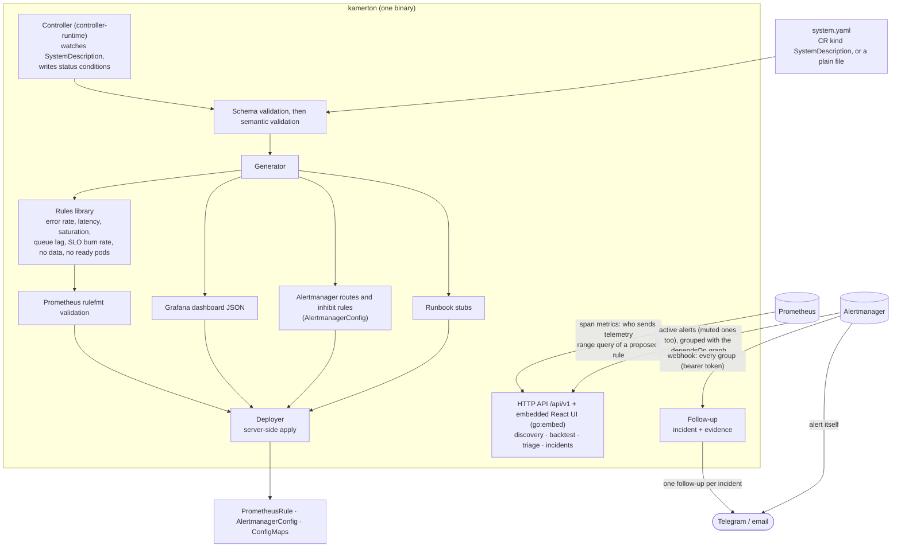
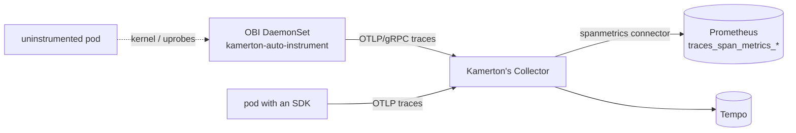

# Kamerton architecture

Kamerton orchestrates an existing open-source observability stack. It does not
replace or fork any of it. It turns one short *system description* into
configuration for those programs and keeps that configuration in sync.



Installed alongside as pinned Helm dependencies: OpenTelemetry Collector,
Prometheus Operator and Prometheus, Alertmanager, Grafana, Loki, Tempo.
Optional and off by default: OpenTelemetry eBPF Instrumentation
(`autoInstrument.enabled`), see below.

## Services without an SDK (eBPF)



The agent exports traces only, never metrics, into the same Collector
pipeline as SDK traces. The spanmetrics connector produces identical metric
names and labels (`service_name`, `span_name`, `span_kind`, `status_code`)
for both sources, so neither the rules, discovery nor the Collector
configuration change. OBI's own span metrics (`application_span_otel`) were
not used: they are a second implementation whose name, unit, buckets and
labels would all have to match the connector's, while traces match by
construction and also land in Tempo.

The agent's configuration file is rendered by the Kamerton chart
(`templates/auto-instrument.yaml`) from the `autoInstrument` values; the
upstream chart only runs the DaemonSet. Capture rules, in OBI's Config v2:
exclude the agent and collector binaries and `excludeExecutables`
(monitoring programs, browsers), the release namespace and
`namespaces.exclude`, pods annotated `kamerton.dev/auto-instrument: "false"`,
pods injected by the OpenTelemetry Operator and processes seen exporting OTLP
(`skipSDKInstrumented`); include `namespaces.include` (all by default).
Exclusions win over inclusions in OBI regardless of order. Because the
ConfigMap belongs to the parent chart, the upstream checksum annotation does
not change with it: the DaemonSet must be restarted after a change.

Where the series differ from SDK ones: the service name comes from
`OTEL_SERVICE_NAME`, then pod annotation, then `app.kubernetes.io/name`, then
the owner workload name; HTTP span names use a path heuristic (`GET
/orders/*`) unless `httpRoutes.patterns` are set; a request with no response
is not an error; server spans of Redis, PostgreSQL and MySQL servers appear
as services of kind server. Details and the duplicate check are in the
README ("Services without OpenTelemetry").

Verified on single-node k3s with the OpenTelemetry Demo: privileged, the
agent's series for a Go gRPC service with its SDK export off had the same
names, labels and span names as the SDK's. With only the documented
capabilities it recorded nothing (no `CAP_SYS_ADMIN` for `setns` into pod
network namespaces), hence the privileged default. The OTLP-export
detection missed nginx with the OTel module, a C++ and a Python grpcio
service, which were counted twice.

## Single source of truth

- **YAML is the source of truth.** The UI is an editor over it (canvas, rule
  cards and YAML mode, all editing the same text).
- **Go types are the source of the schema.** `api/v1alpha1` → `controller-gen`
  → CRD (`deploy/helm/kamerton/crds/`) → `hack/schemagen` → JSON Schema
  (`internal/schema/systemdescription.schema.json`, embedded in the binary).
  The same schema validates descriptions in the core, and gives the YAML editor completion and hover
  (CodeMirror 6 YAML mode: completion and hover from the schema, Russian hints from `web/src/i18n/schema-ru.ts`). `make generate` regenerates everything; a unit test fails if
  the embedded schema is stale.

## Packages

| Package | Responsibility | State |
|---|---|---|
| `api/v1alpha1` | Description types (CRD + file form) | real |
| `internal/schema` | CRD → JSON Schema conversion, schema validation | real |
| `internal/description` | Load, validate (schema + semantic), defaults for metric names | real |
| `internal/rules` | Rule templates; rendering and validation with Prometheus' `rulefmt`; rules without team thresholds (`normal.go`: OOMKilled, near the limit, CPU/latency far above the previous hour) | real |
| `internal/generator` | Description → rules, dashboard, Alertmanager config, runbooks | real (dashboard minimal) |
| `internal/deployer` | Bundle → Kubernetes objects (extra labels of the system's set on PrometheusRule / AlertmanagerConfig); server-side apply | real (runs on a k3s cluster); objects carry an owner reference to their SystemDescription, so deleting a system removes them, but an object a system stops generating is not pruned while the system exists |
| `internal/controller` | Reconciler, status conditions; puts the labels of the system's set on its objects; a change of the sets ConfigMap re-reconciles every system | real (tested with fake client) |
| `internal/discovery` | Services from span metrics | real (needs Prometheus) |
| `internal/backtest` | Firing episodes of a rule over history | real (needs Prometheus) |
| `internal/triage` | Probable source on the dependency graph; incidents (roots, affected services) from active alerts, using the same links as the generated inhibit rules | real |
| `internal/evidence` | Evidence about a root service: workload changes in the last 30 minutes (pods, ReplicaSets, StatefulSets, Warning events), operations with most failed calls (span metrics, query built by the rule library), an error log line (Loki), a Grafana Explore link to failing traces (Tempo); short timeout per collector, bounded total | real (tested with fake Kubernetes, Prometheus and Loki) |
| `internal/followup` | Alertmanager webhook notifications → incident → evidence (and the likely cause among the dependencies of a root whose own alert came first) → one follow-up message per incident to the chats and addresses that got the alert, after a short delay; sent incidents in the ConfigMap `kamerton-followup-state` (memory when it cannot be written); last evidence per incident in memory for the alerts API | real (tested with fakes) |
| `internal/history` | Incident records (open and closed) with the follow-up's evidence and people's notes, in the ConfigMap `kamerton-incident-history` (memory without a cluster); recall of the earlier incident of the same root; "what helped" replies from Telegram | real (tested with a fake Bot API and a fake Kubernetes client) |
| `internal/noise` | Noise statistics per rule from `ALERTS`/`ALERTS_FOR_STATE` (two range queries per system), muted consequences replayed with `triage.MutingEdges`, the "noisy" definition, suggestions through the backtest (`generator.Tunables` names the description field of each rule kind), "useful / noise" counters in the ConfigMap `kamerton-noise-state` (memory without a cluster), the Telegram buttons and their presses | real (tested with fake Prometheus, a fake Bot API and a fake Kubernetes client) |
| `internal/clients/*` | Prometheus (official client), Alertmanager v2 | real |
| `internal/stack` | Sets of programs: the built-in set from the flags (addresses can be overridden and reset), sets added in the UI with extra labels for PrometheusRule / AlertmanagerConfig; stored in the ConfigMap `kamerton-stacks` (cluster), `.kamerton-stacks.json` next to the descriptions (local) or memory. Identity checks of an address per program (health path + build info / status). Discovery through the Kubernetes API: Services in all namespaces recognised by labels, operator service names and typical ports, confirmed over HTTP (bounded concurrency, short timeouts); Prometheus Operator `Prometheus`/`Alertmanager` resources → selector labels and warnings when instances cannot be told apart | real (unit-tested with a fake Kubernetes client and fake HTTP servers; used on a k3s cluster with a second Prometheus) |
| `internal/descstore` | Systems: SystemDescription resources (cluster) or files (local); list, create, save, update, delete | real (tested through the API in both modes) |
| `internal/telegram` | Bot API client, token Secret, chat state ConfigMap, chat discovery (leader-only polling), test messages, routing into the description | real (tested with a fake Bot API) |
| `internal/email` | Mail server settings (password in a Secret, the rest in a ConfigMap), named recipients, SMTP check and test emails, keeps managed `email-<id>` receivers in every system in sync | real (tested with a fake sender and a tiny SMTP server) |
| `internal/server` | HTTP API and SPA serving; optional login (one shared user from `KAMERTON_AUTH_USER`/`KAMERTON_AUTH_PASSWORD`, HMAC-signed 12 h session cookie, in-memory login rate limit, `X-Requested-With` required on state-changing requests; no roles, needs HTTPS at the ingress) | real |
| `web/` | React UI, embedded via `web/embed.go`: systems, canvas, rules, YAML mode, channels | real |

## Rule design notes

- Metric and label names come from `spec.telemetry`; defaults follow the
  OpenTelemetry span metrics connector and cAdvisor, nothing is tied to a demo.
- Error-rate and latency rules carry a **minimum-traffic** condition so a single
  failure in an idle service does not page.
- Error rate can be evaluated **per operation** (`perOperation: true`) and
  operations can have their own thresholds; operations with their own policy
  are excluded from the aggregated per-operation rule.
- `excludeOperations` removes noisy spans (e.g. streaming endpoints).
- `rateWindow` defaults to 5m; a warning is raised below 2m because span
  metrics are typically flushed once a minute.
- Saturation rules use `max by (namespace, pod)` because cAdvisor exports a
  pod-level series next to per-container ones.
- SLO burn-rate alerts follow the multiwindow, multi-burn-rate scheme of the
  Google SRE workbook; factors are derived from the SLO window.
- **Requests stopped arriving** (`trafficDrop`, alert `KamertonRequestsStopped`):
  a service nobody can reach has no error spans, it just stops receiving calls.
  The rule compares the current rate of incoming calls (server/consumer spans,
  `rateWindow`) with the service's normal rate: the average of 10-minute rates
  over the last day, taken only where data exists (gaps such as a sleeping
  machine neither lower nor remove it), summed over all series of the service
  (a collector restart re-creates every series under a new
  `collector_instance_id`), and existing only with at least an hour of
  history. It fires at or below `threshold`
  (default 10%) of normal when normal is above `minRequestsPerSecond` (default
  0.02/s, about one call a minute: quieter services go minutes without a call),
  for `for` (default 2m). No calls at all (rate exactly 0, or no series: the
  Collector drops a silent service's series 2m after its last span) count
  only while traffic is expected now (below), so an idle hour is not an
  outage; a fall to a few percent of normal does not need that. It stays
  silent while fewer than half of the
  system's services seen in the last day have data now or one window ago:
  then the telemetry pipeline has stopped or is restarting, not the service.
  On by default for critical http/grpc services only; queues and databases
  have no incoming spans of their own and get it only when set on the service.
  The value is calls per minute, the notification adds the normal rate.
  Expression semantics are tested with Prometheus' engine (`promqltest`) on
  synthetic series for each failure mode (`internal/rules/traffic_test.go`).
- **Expected traffic** (`expectedNow` in `internal/rules/traffic.go`): the
  same 10-minute rates as the normal, summed over the series, averaged over
  the two hours centred on this time a week ago, present only when every one
  of the 12 steps has data, and above the floor (`minRequestsPerSecond` of
  the service's merged `trafficDrop`, even where that rule is off; for the
  system, the total with `defaults.trafficDrop`). When the selection has no
  data at all in the day before that week (a service younger than a week,
  or Prometheus retention under 8 days), the same window a day ago decides.
  Why not the day average the normal uses: it ignores empty steps by design,
  so it stays high all night and cannot tell idle from broken. Why every
  step: a usual start or stop that moves by up to an hour is not an outage;
  the cost is no report in the hour after the usual start and before the
  usual end, and an alert about a day-time service that stays down resolves
  an hour before its usual end and fires again next morning. Why a week:
  weekends; yesterday alone would page every Saturday for a weekday tool and
  miss Mondays. Holidays a week ago blind the same weekday once. With less
  than a day of history nothing is expected; with retention under a day,
  never. Offsets are in UTC, so a daylight-saving change moves the window by
  an hour for one week.
- **No data** (`KamertonTelemetryMissing`, `KamertonServiceTelemetryMissing`,
  `internal/rules/nodata.go`): every other rule is an expression over span
  metrics and returns nothing without samples, so a broken pipeline would
  look like silence. "Sent before" is: the service had a sample at one of the
  10-minute steps of the last day (`count_over_time((group by (svc)
  (calls))[1d:10m])`; each step sees the 5 minutes before it, so a service
  must send for about a quarter of an hour). Never instrumented: never fires;
  silent for a day (renamed, removed): resolves by itself; a Prometheus
  restart keeps the TSDB, and the 1-minute pending period covers the first
  evaluations before remote write catches up; with storage lost, "before" is
  lost too. "No data now" is `present_over_time(calls[after])` (default 3m:
  two flushes of the Collector at its slowest usual interval), a range and not
  an instant lookup because remote write leaves no staleness markers. The
  system rule (critical, no `service` label, group `kamerton/<system>`,
  runbook `_system`) fires when none of the services has data; the
  per-service one (http/grpc, or `noData` set on the service) when the
  service has none while another service of the system has some. Severity
  of the per-service one: its "requests stopped" rule's severity where that
  rule is on, else warning. Both fire only while traffic is expected now
  (per service with span metrics of any kind, for the system its total). The
  per-service rule is also silent while the service's "requests stopped"
  rule covers the stop: normal above its floor, expected traffic on its
  incoming spans, and enough services visible (the rule's own terms, in
  PromQL, so there is no race in Alertmanager). Then that rule, a symptom
  source for the grouping, fires about 2 minutes after the last call (rate
  window 2m) plus its 2m pending period, and stays firing when the series
  vanish: one notification, no resolve in the middle. "No data" speaks for
  services without that rule and when the visibility guard fails while some
  services still send (part of the pipeline down). Both carry
  Kamerton's own message text and first steps (`kamerton_message_text`,
  `kamerton_message_action`), which a team message replaces.
  Series vanish only if the Collector stops exporting them: the spanmetrics
  connector keeps a resource (one pod of one service) as flat counters
  forever unless `metrics_expiration` is set (bundled Collector: 2m, removed
  on the first flush at least 2m after its last span). A resource that
  comes back starts its counters from zero; rate() reads the drop as a
  reset, and only a series whose old total was not above the new one loses
  those calls (a pod idle longer than 2m that gets about one call per
  active spell). `series_expiration` is not set: it would do the same per
  operation and status, where quiet series are common. A service whose pods
  all go down gets "no ready pods" about a minute in, then "requests
  stopped" (critical) or "no data" (others) a few minutes later: two facts,
  two notifications, as before. Scenarios with expiring series are tested
  with Prometheus' engine in `internal/rules/nodata_scenarios_test.go`.
- **No ready pods** (`KamertonNoReadyPods`, `internal/rules/pods.go`): from
  kube-state-metrics `kube_pod_status_ready{condition="true"}` with the
  workload locator of the saturation rules. Fires while pods exist and none
  is ready (crash loop, failing probe, image pull), or when no pod is left
  within an hour of the last ready one (`max_over_time(...[1h:1m])`). The
  scrape writes a staleness marker when a pod's series goes, so the rule sees
  the pod gone at the next scrape; pending 30s gives about a minute in all.
  kube-state-metrics' Deployment and StatefulSet series
  (`kube_deployment_spec_replicas`, `kube_statefulset_replicas`, `..._ready`)
  carry the workload name, which the pod locator does not know; and a scale
  to zero sets the same replica count as an intentional one, so a long scale
  to zero is told apart only by time: the alert stops an hour after the last
  ready pod and never fires for a service at zero when the rule appears.
- Every generated rule file is parsed with Prometheus' own `rulefmt` before it
  leaves the generator.

## Sets of programs

A system reads Prometheus and Alertmanager through the clients of its set
(`spec.stack`, empty = the built-in set; an unknown ID falls back to the
built-in set with a warning): service discovery, backtest, rule states,
active alerts and triage, the alert counts of the system list. The
all-systems alerts endpoint asks every Alertmanager used by some system and
merges duplicates. Clients are cached per address; the install-time address
uses the client built from the flags. On the write side the set's
`ruleLabels` / `alertmanagerConfigLabels` go on the system's PrometheusRule /
AlertmanagerConfig (Kamerton's own labels always win); the controller
watches only the sets ConfigMap (the manager's ConfigMap cache is limited to
it) and re-reconciles every system on a change. Two Operator-managed
instances that both select every object cannot be separated by labels; the
status page says so.

## Systems

One SystemDescription (cluster) or one YAML file (local, `--description a.yaml,b.yaml`
or a directory) is one **system**. The store (`internal/descstore`) lists, creates,
saves and deletes them; a system's ID is its name, or `name~namespace` when two
descriptions in different namespaces share a name. Telegram bots and chats are shared
by all systems; receivers and routes are per system.

## UI model

YAML is the stored truth of a system. The UI keeps a draft text and the last
description that parsed (`web/src/lib/model`): the canvas, the rule editors and the
"where alerts go" panel turn the description into pictures and write their changes
back into the YAML document node by node (comments and formatting of untouched parts
survive). While the text does not parse, the canvas shows the last valid version and
is read-only. Node positions live in the annotation `kamerton.dev/layout`
(metadata, not spec: they change nothing that is generated, survive restarts, and a
description without them is arranged automatically). Saving from the UI keeps
`kamerton.dev/*` annotations on the resource and leaves other metadata alone.

## API

| Method | Path | Notes |
|---|---|---|
| GET | `/healthz`, `/api/v1/health` | liveness |
| GET | `/api/auth/session` | whether login is on and whether this request has a session |
| POST | `/api/auth/login`, `/api/auth/logout` | `{username, password}` → session cookie; logout clears it |
| GET | `/api/v1/version` | build info |
| GET | `/api/v1/schema` | JSON Schema of the description |
| GET | `/api/v1/systems` | systems with services, rules, receivers, active alerts and state |
| POST | `/api/v1/systems` | YAML body → new system; 409 `exists` |
| GET/PUT/DELETE | `/api/v1/systems/{id}` | read (YAML, validity), save (name must not change), delete |
| POST | `/api/v1/systems/{id}/validate` | draft YAML → `{valid, errors, warnings}` |
| POST | `/api/v1/systems/{id}/rules/preview` | draft YAML (or empty: stored) → rule file |
| GET | `/api/v1/systems/{id}/rules/state` | current rule states from Prometheus `ALERTS` |
| GET | `/api/v1/systems/{id}/discovery` | services in telemetry; `described` for this system, `inSystems` for others |
| POST | `/api/v1/systems/{id}/backtest` | `{yaml, service, alert, operation, range}` (a rule of a draft) or `{expr, for, range}` |
| GET | `/api/v1/systems/{id}/runbooks/{service}` | runbook of a service; `_system`: the alerts about the whole system (`service: {name: "_system", system: true}`); `experience`: notes of the last incidents with the service as a root |
| GET | `/api/v1/systems/{id}/alerts` | active alerts of the system (same shape as `/api/v1/alerts`) |
| GET | `/api/v1/systems/{id}/noise` | `?window=1d\|3d\|7d` (default 7d): per rule fired, short, longest, last firing, verdicts, `noisy`, optional `suggestion` (see Noise) |
| POST | `/api/v1/systems/{id}/noise/feedback` | `{alert, service, operation?, verdict: useful\|noise}` → `{recorded, alert, service, operation, feedback}` |
| GET | `/api/v1/systems/{id}/telegram`, PUT `…/telegram/routing` | Telegram status / routing for this system |
| GET | `/api/v1/stack` | health of the programs of one set (`?set=`, default the built-in one) |
| GET | `/api/v1/stacks` | sets with programs (address, origin `bundled`/`own`/`none`), health and version, systems using each, warnings; discovery availability |
| POST | `/api/v1/stacks` | `{id?, name, urls: {kind: url}, ruleLabels, alertmanagerConfigLabels}` → new set; ID derived from the name when empty |
| PUT/DELETE | `/api/v1/stacks/{id}` | rename / change labels (fields present are changed); delete (409 `in_use` with the systems, 409 `builtin`) |
| PUT/DELETE | `/api/v1/stacks/{id}/programs/{kind}` | `{url}` sets an address (http/https only, no credentials); DELETE resets the built-in set's address to the install-time value or disconnects it in another set |
| POST | `/api/v1/stacks/check` | `{kind, url}` → `{state: ok, not_ready, no_answer, wrong_program, no_access, bad_url; version, message}`; only GETs go to the address |
| GET | `/api/v1/stacks/discover` | programs found in the cluster (`kind, namespace, service, url, version, healthy, state, operator, usedBy`), operator resources, warnings; `{available: false, reason}` outside a cluster |
| GET | `/api/v1/alerts` | active alerts of all systems from every Alertmanager in use (merged by fingerprint), with plain-words title, value, threshold and probable source; `muted` (alerts muted by grouping by cause) and `incidents` with optional `evidence` (see Incidents) |
| GET | `/api/v1/incidents/history` | `?system=&service=&limit=50` (all optional; limit at most 300): records, most recent first (see Incident history) |
| PUT | `/api/v1/incidents/history/{id}/note` | `{cause, fix}` (a field left out is kept, `""` clears it; trimmed; at most 200 / 500 characters, else 400 `too_long`) → the record |
| POST | `/api/v1/hooks/alertmanager` | Alertmanager webhook (payload version 4); `Authorization: Bearer <token>` from the Secret `kamerton-webhook`; no session, no `X-Requested-With`; 404 `not_available` when follow-up messages are off |
| GET | `/api/v1/settings` | external URL (links on/off), storage mode, namespace, Telegram and email availability, `followUp: {available, reason}` |
| GET | `/api/v1/runbooks/{service}` | runbook found by service name (`?system=` to choose); behind `runbook_url` of rules |
| GET/PUT | `/api/v1/description` | single-description API of earlier versions: the default system |
| POST | `/api/v1/description/validate`, `/api/v1/rules/preview`, `/api/v1/backtest` | stateless helpers |
| GET | `/api/v1/discovery/services` | discovery relative to the default system |
| GET | `/api/v1/telegram` | bot, polling health, chats with routing (`?system=`) and the systems using each chat |
| PUT | `/api/v1/telegram/token` | `{token}` → getMe → Secret; returns only the bot's public name |
| DELETE | `/api/v1/telegram/token` | removes receivers using it (in every system), the token, and discovered chats |
| POST | `/api/v1/telegram/chats` | `{chatID}`: check a chat by ID (getChat) and remember it |
| DELETE | `/api/v1/telegram/chats/{id}` | removes the chat's receivers (in every system) and forgets it |
| POST | `/api/v1/telegram/chats/{id}/test` | sends a test message; `{ok, error, migratedTo}` |
| GET | `/api/v1/email` | mail server (never the password), recipients and the systems using each |
| PUT | `/api/v1/email/server` | `{smarthost, from, username, password}` → SMTP login check → Secret; empty password keeps the stored one; updates managed receivers |
| DELETE | `/api/v1/email/server` | removes recipients' receivers (in every system), the password, settings and recipients |
| POST | `/api/v1/email/recipients` | `{name, to[]}`: remember a recipient |
| PUT | `/api/v1/email/recipients/{id}` | change name/addresses; updates the addresses in every system |
| DELETE | `/api/v1/email/recipients/{id}` | removes its receivers (in every system) and forgets it |
| POST | `/api/v1/email/recipients/{id}/test` | sends a test email; `{ok, error}` |
| PUT | `/api/v1/telegram/routing` | `{chats:[…]}` → receivers and routes in the default system (`?system=` to choose) |

## Secrets

Credentials never appear in the description, the chart values or the
repository. Telegram tokens and SMTP passwords are referenced as Secret keys and
copied by reference into `AlertmanagerConfig`. The Grafana admin password is
generated by the Grafana chart into its own Secret.

Alertmanager sends the value of a referenced Secret to the receiver's endpoint
(the SMTP password goes to `smarthost`), so a description saved through the
HTTP API may reference a Secret only when:

- a Telegram receiver names Kamerton's own token Secret, in Kamerton's namespace;
- an email receiver names Kamerton's own SMTP Secret together with the mail
  server and login configured in Kamerton (another `smarthost` is refused);
- the stored version of the same system already had that exact reference (for
  email: with the same `smarthost` and login), which keeps descriptions applied
  with kubectl by a cluster admin editable in the UI.

Anything else is refused with 400 `secret_not_allowed`; the validate and preview
endpoints report the same error. The API creates descriptions only in
Kamerton's namespace (or the single watched one; 400 `namespace_not_allowed`).
`runbookURL` and `--external-url` must be absolute http(s) URLs.

The Telegram token entered in the UI is written by the core into the Secret
`kamerton-telegram` (key `bot-token`) in Kamerton's namespace, the same name a
hand-written description references. The core reads it with direct GETs (an
uncached client), so RBAC grants get/update/patch/delete on that one Secret by
name plus `create` on Secrets in the namespace (Kubernetes cannot restrict
`create` by name) and no list/watch. The token is sent only to the Bot API;
transport errors (which embed the request URL) are scrubbed before they reach
logs or responses.

The webhook token of follow-up messages is generated by the core (256
random bits) into the Secret `kamerton-webhook` (key `token`) in its
namespace at startup when missing; the same Role grants get/update/patch/
delete on it by name. Generated AlertmanagerConfigs reference it under
`httpConfig.authorization.credentials`, so only descriptions in Kamerton's
namespace get the webhook (the Prometheus Operator drops a whole
AlertmanagerConfig whose Secret it cannot read, and that would stop the
alerts themselves).

## Telegram chat discovery

The Bot API has no "list my chats" call. The core long-polls `getUpdates`
with `allowed_updates = [my_chat_member, message, channel_post, callback_query]`
(requested explicitly because Telegram remembers the last setting;
`callback_query` carries the presses of the buttons under follow-ups, see
Noise):

- `my_chat_member`: the bot was added (member/administrator, restricted with
  `is_member`) or removed (left/kicked) → chat available or unavailable;
- `message.migrate_to_chat_id` / `migrate_from_chat_id`: a group became a
  supergroup → the stored chat and every description receiver using the old
  ID move to the new ID; getChat/sendMessage errors carrying
  `parameters.migrate_to_chat_id` are handled the same way;
- any other message or channel post reveals the chat (and title changes);
- a text message replying to one of the bot's "incident is over" messages
  (`reply_to_message`) is also a "what helped" note (see Incident history).
  The Bot API delivers replies to messages meant for the bot in groups even
  in privacy mode ("Privacy mode" in core.telegram.org/bots/features), so
  `message` in `allowed_updates` is enough; the sender is not decoded.

Only the leader polls (the polling loop is a controller-runtime runnable that
needs leader election; the chart requires leader election for more than one
replica), because a bot allows one `getUpdates` consumer and none while a
webhook is set; a 409 from Telegram is shown in the UI. State (bot name,
offset, chats, poll health) lives in the ConfigMap `kamerton-telegram-state`
in Kamerton's namespace: it survives restarts, is shared by replicas (any
replica serves the UI), needs no volume, and holds nothing secret. Updates
older than 24 hours are gone, so chats joined before polling started are
checked by ID (getChat) from the UI, and chats referenced by the description
are probed once per bot.

## Notifications

A rule may carry the team's own notification text (`message: {title, text,
action}` on the policy the rule comes from, `memoryMessage`/`cpuMessage`/
`restartsMessage` on saturation, `message` on custom rules), in any language.
Placeholders are a fixed list: `{value}`, `{threshold}`, `{service}`,
`{operation}`, `{system}`, `{since}`; other braces and any markup are rejected
by validation. The generator fills the first five into the annotations
`kamerton_message_title|text|action` (as Prometheus templates); `{since}` is
filled by the Alertmanager template (`reReplaceAll`). Values are escaped by
Alertmanager (html/template for Telegram and email HTML). A message about one
alert shows title, value, text and the "👉" action; a grouped message lists
only title and value per alert.

Telegram and email receivers use Kamerton's own templates
(`internal/generator/message.go`) instead of Alertmanager's defaults:
state, severity, system/environment, per alert the service, a plain-words
title, the current value and threshold, and the start time; grouped alerts
are listed compactly (at most 8, then a count). Times are written in
`spec.notifications.timeZone` (IANA name, default UTC) with the offset as label,
"09:18 16.11 UTC+5". Kamerton resolves the zone with Go's time-zone database
(embedded in the binary) and writes fixed offsets into the template, switching
at daylight-saving changes it computes for a year back and three years ahead;
the template only calls `time.Time.Add`. Alertmanager's own `tz` function
(v0.27+) is not used: it fails for names missing from the image's zoneinfo
(the v0.35.0 image ships Debian's canonical names only, no `Asia/Calcutta` or
`Europe/Kiev`) and a failing function drops the whole notification. The words come from rule
annotations `kamerton_title`, `kamerton_value`, `kamerton_threshold`, written
by the rule library in `spec.notifications.language` (en by default, ru),
next to the English `summary`/`description`. Alertmanager executes the
Telegram message (parse mode HTML) and the email HTML with html/template, so
values are escaped. Links go only to the external URL (`/alerts?...` and
`/runbooks/<service>/<alert>` in the UI); without it there are no links.

## Incidents

### Grouping by cause (inhibit rules)

`spec.notifications.groupByCause` (default true) adds `spec.inhibitRules`
to the AlertmanagerConfig (`internal/generator/inhibit.go`). Symptom sources
are `KamertonErrorRateHigh`, `KamertonOperationErrorRateHigh`,
`KamertonLatencyHigh`, `KamertonOperationLatencyHigh`,
`KamertonLatencyAboveNormal`, `KamertonRequestsStopped` and
`KamertonNoReadyPods` (`rules.SymptomSources`): what a failing dependency
fires. Symptom targets are the same without `KamertonNoReadyPods` and with
`KamertonSLOBurnRateFast` and `KamertonSLOBurnRateSlow`
(`rules.SymptomTargets`): what a caller fires because of it. No ready pods is
a cause of the service's own, never a consequence; a caller's burning budget
is a consequence, but proves nothing about the services it calls. For each
service with callers there are two rules: a critical source alert of the
service mutes target alerts of its direct callers of any severity; a
warning mutes only their warnings (a warning may be routed nowhere and must
not hide a critical alert). Alertmanager lets a muted alert act as a source,
so chains collapse to the deepest failing service. Every matcher names
`kamerton_managed` and `kamerton_system` (inhibit rules apply to every alert
of the Alertmanager). Source and target name different services, so no
alert inhibits itself; links inside a dependency cycle are dropped
(`triage.MutingEdges`), so two services that call each other never mute each
other. Resource (memory, CPU, restarts, OOMKilled), queue, "no data" and
custom alerts neither mute nor are muted, except starved ones (below). One more rule, generated whenever
the system "no data" rule is on, whatever `groupByCause` says:
`KamertonTelemetryMissing` mutes `KamertonServiceTelemetryMissing` of the
same system.

Starvation is the other direction: a failing service takes traffic away
from the services it calls, and from the consumers of a queue it produces
to. `triage.Feeders` lists, per service, its direct callers and the
producers of the queues it consumes (a consumer depends on the queue and is
named in `queue.consumerGroups`; every other service depending on the queue
is a producer), without links inside a cycle of feeding. With
`groupByCause` on, the "no data" and "requests stopped" rules of a fed
service multiply their result by a one-series vector that carries
`kamerton_starved="true"` while (in `ALERTS`, firing, same system) a
feeder has an alert that the service did not cause and the service has no
error, latency or "no ready pods" alert of its own. A queue producer's
alert always counts (a consumer cannot make its producer fail). A direct
caller's alert counts when it is "no ready pods", "no data" or "requests
stopped" (the caller stopped calling for its own reason), or when another
dependency of the caller has an unstarved symptom source (the caller's
errors come from there). Without that last condition an unreachable
service would be taken for starved by the callers failing because of it.
The value of the rule is unchanged; the label changes the alert's identity,
so an alert that becomes starved starts a new pending period (the feeder
fires within 1 to 2 minutes, a starved "no data" needs about 6 and a
"requests stopped" about 4, so in practice it is born starved). Two inhibit
rules per fed service (critical feeder alert mutes any, warning mutes
warnings) mute `KamertonServiceTelemetryMissing|KamertonRequestsStopped`
with `kamerton_starved="true"` of the service while any symptom, "no data"
or "requests stopped" alert of a feeder fires; a muted one counts, so a
chain of starved services closes. The dependency rules add
`kamerton_starved!="true"` to their sources: a starved "requests stopped"
explains nothing upstream, which also keeps the two kinds of rules from
muting each other in a loop. Why PromQL decides and Alertmanager only
mutes: an inhibit rule cannot ask whether the service has an alert of its
own or whether the caller's alert is explained elsewhere, and without those
checks the dependency rules and the starvation rules would mute each other
(nobody told). The demo gets 57 inhibit rules (1 system, 26 dependency, 30
starvation). `triage.Incidents` makes the same decision on the active alerts
(repeated until it settles) and lists starved services as affected;
`internal/noise` counts muted starved firings as consequences from the
label.

The Prometheus Operator adds `namespace="<namespace of the
AlertmanagerConfig>"` to both sides of an inhibit rule (and to routes)
unless `alertmanagerConfigMatcherStrategy` is `None`. Span-metric alerts have
no `namespace` label, so the bundled chart sets `None`; a Prometheus
Operator with the default strategy matches neither Kamerton's routes nor its
inhibit rules.

`triage.Incidents` applies the same links to the active alerts of a system
(the alerts API asks Alertmanager with `inhibited=true`): a service with a
target alert whose direct dependency (by muting links) has a source alert is
affected, unless it has no ready pods itself; the others are roots; roots
that share an affected service form one incident. Alerts without a
`service` label (the system "no data" alert) form the incident
`<system>:_system` with no roots; while it exists, the per-service "no data"
alerts it mutes are its affected alerts. The alerts API adds:

```json
{
  "alerts": [{"…": "as before", "fingerprint": "f1", "muted": false, "incident": "shop:payment"}],
  "muted": [{"…": "same shape as alerts", "muted": true, "incident": "shop:payment"}],
  "incidents": [{
    "id": "shop:payment",
    "system": "shop",
    "roots": ["payment"],
    "rootAlerts": [{"fingerprint": "f1", "name": "KamertonRequestsStopped", "service": "payment",
                    "severity": "critical", "startsAt": "…", "title": "…", "value": "…", "muted": false}],
    "affected": ["checkout", "frontend"],
    "affectedAlerts": [{"…": "same shape", "muted": true}],
    "startsAt": "…",
    "evidence": {
      "collectedAt": "2026-11-16T04:18:12Z",
      "cause": "payment: Requests stopped arriving since 09:18 UTC+5",
      "likely": false,
      "changes": ["new version at 09:14 UTC+5 (v1.4.2 -> v1.4.3)", "container payment restarted (OOMKilled)"],
      "operation": "oteldemo.PaymentService/Charge",
      "operationFailures": 42,
      "logLine": "card declined: upstream timeout",
      "tracesURL": "https://…",
      "explains": ["checkout"]
    }
  }]
}
```

`evidence` is the last evidence the follow-up collected for the incident ID,
kept for a day (at most 200 incidents) in the memory of the replica that got
the webhook; every field is optional and strings are in the description's
language and time zone. `cause` describes the first root, or with
`likely: true` the dependency named as the likely cause (`changes`,
`operation`, `logLine` and `tracesURL` then come from that dependency, a
missing part from the root). `explains` lists services of earlier
follow-ups this incident turns out to cause.

### Follow-up message

With `incidents.followUp.enabled` (Helm, default on; flag
`--alertmanager-webhook-url`) the core makes sure the webhook token Secret
exists, and the generator adds a last child route with `continue: true` and
receiver `kamerton-webhook` (`webhookConfigs`, `sendResolved`, bearer
authorization from the Secret) to AlertmanagerConfigs of descriptions in
Kamerton's namespace whose `spec.notifications.evidenceFollowUp` is not
false. The routes before it are unchanged, so Telegram and email keep
getting the alert straight from Alertmanager.

On a firing notification (`internal/followup`) the core answers at once,
waits until 45 seconds after the notification (the root alert, such as "no
ready pods", now usually comes first and its callers' alerts 15 to 60
seconds later; the wait fills "also affected"), and then makes an attempt:
finds the system by `kamerton_system`; reads its alerts with muted
ones from the Alertmanager of its set (the notification's alerts when that
fails); groups them into incidents; for each incident of the notification
claims `system:roots@start` in the ConfigMap `kamerton-followup-state`
(optimistic concurrency, so one replica at a time; a lease of 2 minutes
covers one attempt and lapses if that replica dies; entries expire after
24 hours, at most 500; when the ConfigMap cannot be written, in memory);
collects
evidence for up to three roots (`internal/evidence`, 5 s per collector, 12 s
in total, failures logged); for a root that shows a symptom target and has
no cause of its own, checks its direct dependencies at that moment (pending
symptom-source alerts in `ALERTS`, and the queries of
`generator.DependencyChecks`: no ready pods, calls far below normal, error
rate, with the dependency's merged thresholds even where its rule is off;
5 s) and names those with observations as the likely cause, with the
evidence of the first; marks the follow-up as an explanation of earlier
sent follow-ups whose roots are now affected or which named one of its
roots as the likely cause; keeps the evidence for the alerts API; renders
the message (`generator.RenderFollowUp`, language
and time zone of the description, Telegram HTML, email HTML and text) and
sends it to the receivers that got the alert (severity routing and service
routes of the description), and marks the incident sent: repeats and group
updates, also after a restart or on another replica, send nothing. Telegram
goes only through Kamerton's bot (receivers naming Kamerton's token Secret),
email only through the mail server configured in Kamerton. The system "no
data" alert gets no follow-up (there is no data to collect from).

An attempt that sends nothing (the evidence says no more than the alert:
no affected services, likely cause, explained alert, changes, failing
operation or log line; nobody got the alert; every channel failed) leaves
the incident open: the same process tries again about 1 and 3 minutes later
(`Rechecks`), and a later notification for the incident tries too. The last
timed attempt gives the incident up, and so does the 6th attempt or one 10
minutes after the first (bounds for attempts started by notifications when a
restart lost the timed ones). Giving up is logged at Info once, with the
reason (`follow-up not sent`); attempts that will be retried log at Debug.
So exactly one follow-up goes out per incident, at most about 5 minutes
after the notification, and an incident with nothing to say costs at most
three collections per notification and never a message.

Evidence parts: workload changes of the root's pods (namespace and pod regex
as the saturation rules use them; without a namespace, the namespace label of
the pods' container metrics in Prometheus): scaling of the workload within
the window from the `ScalingReplicaSet` events of its Deployment (type
Normal, "Scaled down replica set … from 1 to 0"; the pods' ReplicaSets, or
with no pod left the ReplicaSets whose pods the regex would match) and the
last `SuccessfulDelete` of a StatefulSet at zero replicas, a workload left at
zero without such an event (then without time), "no pods exist" when the
workload exists but has none, the newest ReplicaSet of a
Deployment created within 30 minutes (old and new image tag), a StatefulSet
rolling out a new revision, containers terminated within 30 minutes or in
CrashLoopBackOff (reason, exit code), pods not ready, the most frequent
Warning events of the pods and their owners. The operation with most failed
calls: `topk(3, sum by (service, operation) (increase(failed calls[30m])) > 0)`
over the selection of the error-rate rules (`rules.FailingOperations`). The
log line: the newest line matching an error pattern in the stream
`{service_name="<telemetry name>"}` of the set's Loki. The trace link: Grafana
Explore at `incidents.grafanaExternalURL` with the Tempo data source (UID
`tempo`) and `{resource.service.name="<telemetry name>" && status=error}`.
Workload reads need the ClusterRole rules pods/events and
replicasets/statefulsets get/list (`incidents.followUp.workloadRead`).
Without a cluster the follow-up is unavailable and `/api/v1/settings` says
why.

### Incident history

`internal/history` keeps a record per incident in the ConfigMap
`kamerton-incident-history` (key `history.json`, optimistic concurrency
like the other state; memory without a cluster). A record:

```json
{
  "id": "3f9a0c1d2e4b5a69",
  "system": "shop",
  "roots": ["payment"],
  "rootAlerts": [{"name": "KamertonNoReadyPods", "service": "payment", "title": "No ready pods", "severity": "critical"}],
  "affected": ["checkout", "frontend"],
  "startedAt": "2026-11-16T04:18:00Z",
  "endedAt": "2026-11-16T04:23:12Z",
  "durationSeconds": 312,
  "endEstimated": false,
  "open": false,
  "evidence": {"…": "same object as the live incident's evidence"},
  "note": {"cause": "…", "fix": "…", "updatedAt": "…", "source": "ui"},
  "aftermath": [{"service": "checkout", "alerts": ["KamertonSLOBurnRateSlow"], "since": "…", "lastSeen": "…"}]
}
```

`endedAt` and `durationSeconds` are absent while open. The ID is the first
16 hex digits of SHA-256 over system, incident ID and start, so the same
incident (same roots, same first alert) seen again after a gap reopens its
record instead of adding one.

**Opening and updating.** Records follow `triage.Incidents` (system-wide
incidents without roots are not recorded). The webhook (firing and
resolved, at once, before the follow-up's wait), each follow-up attempt, the
sweep and `GET /api/v1/alerts` observe a system's incidents. An open record
with the same incident ID follows the current view: its roots are replaced,
its root alerts are the alerts of the current roots only (earlier alerts of
the same roots kept, at most 5, the most explaining first), affected
services accumulate (up to 20, former roots included), the earliest start
stays; `incident` keeps the last incident ID, also after the record
closes. Otherwise a record with the same ID reopens, or the incident is
aftermath (below), or an open record without a note whose roots are now
among the incident's roots or affected services is taken over (the
caller's alert came first, then the dependency's), or a record is opened.
Other open records whose roots a live incident now explains are merged into
its record (earliest start, follow-up receivers and note kept, their IDs in
`merged`): one incident, even when a caller's record was opened before
triage knew the cause. The follow-up layer needs nothing new for this: an
attempt re-triages, so a caller's follow-up not yet sent becomes the
cause's, and one already sent is named by the cause's follow-up ("This
explains the earlier alert about checkout"). The follow-up adds its
evidence and the names of the Telegram receivers that got it.

**Aftermath.** After an outage, callers' alerts are unmuted for a moment
and SLO burn alerts keep firing until their window no longer holds the
errors (the slow burn's short window is 30 minutes). An incident whose root
alerts are all symptom targets (errors, latency, stopped requests, SLO
burn), whose roots were all roots or affected services of a record that is
open or ended within `AftermathGrace` (35 minutes: that 30 minute window
plus 5 for rule evaluation and Alertmanager), is that record's aftermath:
no record, no follow-up (`aftermathOf` and the record's `historyId` in the
alerts API), and its alerts are listed on the record (`aftermath`: at most
10 services, 5 alert names each, first and last seen). The root's own SLO
burn left after its real alerts resolved ends the record the same way. An
alert of a service's own (no ready pods, restarts, memory, custom rules) is
never aftermath and opens its own incident with a follow-up. Aftermath
still firing when the grace period ends becomes an incident of its own
from that moment (`promoted`, start = end + 35 minutes); since Alertmanager
notified while it was a tail, the sweep starts its follow-up (the usual
attempt bounds apply). The sweep watches systems with open records and,
for 50 minutes after the end, systems whose record has aftermath.

**Closing.** A resolved notification gives the end: when every root alert
of the record's last view is in it, the latest `endsAt` is the end; the end
is the moment the roots resolved, whatever aftermath follows. An observation
in which the system's Alertmanager answered closes the other open records
of that system: at the time of the observation when the record was seen
within 10 minutes, else at the time it was last seen with `endEstimated`.
So a missed resolve is caught by the next notification of the system, by
`GET /api/v1/alerts`, or by the leader's sweep every 5 minutes (only
systems with open records or recent aftermath are asked). Merged records
are gone, so only the record they went into is closed; promoted aftermath
closes like any record. A record nobody could confirm for 24
hours (Alertmanager not answering) closes at its last-seen time, estimated;
a record of a deleted system closes at the next sweep.

**Bounds.** At most 300 records and 180 days: a few incidents a week over
half a year, enough for "it happens every quarter" and for a count over 30
days. Strings are capped (titles 120 characters, evidence cause 200, each
of at most 3 changes 160, log line 200, a traces link longer than 1000
bytes dropped; notes 200 and 500). A typical record is 1 to 2 KB, so the
state stays near half of the 1 MiB a ConfigMap holds; when the JSON would
exceed 900 KiB anyway, the oldest closed records go first (those without a
note before those with one), open records last.

**"Incident is over".** When an observation closes a record (exactly one
replica gets it, through the ConfigMap's optimistic concurrency) that had a
follow-up in Telegram, whose end was seen (not estimated), that lasted at
least 2 minutes, and `spec.notifications.askWhatHelped` is not false (it
needs the follow-up too), the follow-up service claims the record and sends
one message, through Kamerton's bot only, to the Telegram receivers that
got the follow-up, in the language of the description. When aftermath was
seen at the end, one line names it ("Still firing after it: checkout (SLO
error budget is burning). This is expected for a while after an outage.").
The chat and message IDs are kept with the record. Email receivers get nothing: a reply
to an email does not come back to Kamerton.

**Replies.** The polling loop (after storing the offset) passes a text
message with `reply_to_message` to the history: a reply to a kept chat and
message ID, from a chat that is still a receiver of the system through
Kamerton's bot, becomes the note's `fix` (trimmed, at most 500 characters,
`source: telegram`), replacing an earlier one. Kamerton confirms with a 👍
reaction (`setMessageReaction`; bots may set one reaction per message and
a chat may limit the allowed emoji) and falls back to a short reply
(`reply_parameters`) when the reaction is refused. A reply that is too long
is answered and not stored; replies to other messages and from other chats
are ignored without an answer.

**Recall.** A follow-up looks up closed records of the same system with
its first root among their roots, preferring those that have the same root
alert as the root's main alert (a symptom source before a target, then the
earliest), falling back to any. The most recent one is shown: when it
started, how long it lasted, the cause (the person's note, else the
collected cause) and what helped, and how many such records started in the
last 30 days. A record with a note makes the follow-up worth sending by
itself. The alerts API adds, per live incident, `historyId` (its open
record) and the same `previous`:

```json
"previous": {"id": "3f9a0c1d2e4b5a69", "startedAt": "…", "durationSeconds": 312, "cause": "…", "fix": "…", "count30d": 4, "noted": true}
```

The runbook data of a service (`GET /api/v1/systems/{id}/runbooks/{service}`
and `/api/v1/runbooks/{service}`) adds `experience`: `[{id, startedAt,
durationSeconds, cause, fix}]`, the last 5 records with a note that have the
service as a root, most recent first. Generated Markdown runbooks are
unchanged.

## Noise

`GET /api/v1/systems/{id}/noise` (`internal/noise`) answers how noisy each
rule of a system was over a window and how to make it quieter. Nothing is
stored and nothing is applied: the UI writes a suggestion back through the
normal description edit.

```json
{
  "window": "7d", "available": true, "reason": "", "shortUnder": "5m", "longFrom": "10m",
  "rules": [{
    "alert": "KamertonErrorRateHigh", "service": "checkout", "operation": "",
    "fired": 40, "short": 37, "consequences": 4, "longestSeconds": 720, "lastFiredAt": "2026-11-16T04:18:00Z",
    "feedback": {"useful": 1, "noise": 5}, "noisy": true,
    "suggestion": {"field": "threshold", "current": "0.05", "suggested": "0.075", "unit": "",
                   "wouldFire": 3, "wouldMiss": 0, "wouldShort": 1, "delaySeconds": 0,
                   "path": "errorRate.threshold", "format": "share"}
  }]
}
```

**History.** Two range queries over the window with a 1m step, whatever
the number of rules: `max_over_time(ALERTS{kamerton_system, kamerton_managed,
alertstate="firing"}[1m])` and the same over `ALERTS_FOR_STATE`, whose value
is the time the alert became active. `max_over_time` over one step sees a
firing shorter than the step. Samples of a series form one firing while
consecutive; across a gap they stay one firing when the activation time is
the same (Prometheus restored the alert after a restart), and a new
activation time starts a new firing even without a gap. Without
`ALERTS_FOR_STATE`, a gap ends the firing, as in the backtest. A sample at
t means the alert fired within (t-1m, t], so durations are measured to the
minute. A firing already on when the window began, or still on at its end,
counts as fired but never as short.

**Consequences.** The history does not know about inhibition, so the
report replays it (`internal/noise/consequence.go`) with the links of
`triage.MutingEdges` (the same as the generated inhibit rules, cycle rule
included; none with `groupByCause: false`) and `rules.IsSymptomSource`/
`IsSymptomTarget`: a firing of a symptom target of service S that overlaps a
firing of a symptom source of a service S depends on directly is a
consequence; a warning source mutes only warnings. Direct links are enough:
a muted source still mutes its own callers in Alertmanager, and its firing
is in the history too. A per-service "no data" firing overlapping the
system-wide one is a consequence as well. Consequences are counted in
`consequences` and left out of `fired`, `short`, the noisy decision and the
suggestion, whose backtest firings at muted times are dropped the same way.
No extra queries: the sources come from the same two history queries.

**Rule identity** is the one the UI uses for rule cards and rule states:
`alert`, `service` and `operation`. The aggregated per-operation rules put
each series' operation into the label; their firings are counted under
`operation: ""`, the card they belong to. Rules that never fired are left
out unless they have verdicts. `available: false` with a plain `reason`
when the set has no Prometheus or it does not answer.

**Definitions** (constants in `internal/noise/noise.go`): short is under
5 minutes (a notification arrives within about a minute, so someone who
opens it finds the problem gone); long is 10 minutes or more. Short alone
proves nothing: a real outage of 4 minutes is short. So without verdicts a
rule is noisy only with at least 10 firings in the window, at least 3 a day
on average (once a shift) and at least three quarters of them short; a bad
day of a few short outages stays below, a rule flapping tens of times a
week does not. At least 2 "noise" verdicts outnumbering "useful" make a
rule noisy; at least 2 "useful" outnumbering "noise" make it not noisy
whatever its history.

**Suggestions** are computed for at most 5 noisy rules (most firings
first) that have short firings and a field to change
(`generator.Tunables`). The backtest of the rule as it is must find at
least half of the real firings (else its metrics are gone or renamed and
any change would look perfect). Candidates in this order:

1. thresholds at most 1.5 times the current one (1.25×, 1.5×; divided for
   custom "<" and "<=" conditions), because they add no delay and still
   mean the same kind of trouble;
2. a longer `for`: 1m, 2m, 3m, 5m, 10m above the current one, at most 3m
   for a critical rule (with evaluation and group wait it still pages
   within about five minutes, the bound the library keeps for its own
   pending periods) and 10m for a warning; each carries `delaySeconds`,
   suggested minus current `for`;
3. larger thresholds (2×, 3×), which change what the rule counts as bad.

Thresholds are rounded to two significant digits; a share stays below 1.
Each candidate is applied to a copy of the description and generated, so
the backtest runs exactly the rule it would produce; a longer `for` reuses
the query of the rule as it is. The first candidate that fires less, leaves
at most 20% of the short firings and overlaps every real firing of 10
minutes or more (same series, by the labels of the expression's result) is
the suggestion. A candidate that would never have fired is skipped unless
the rule fired at least 20 times: below that it mostly switches the rule
off. At most 1 + 4 range queries per rule, three rules at a time, within
the request's 60 s.

| Rule kind (alert) | `threshold` field | unit, form | `for` field |
|---|---|---|---|
| `KamertonErrorRateHigh`, `KamertonOperationErrorRateHigh` (aggregated) | `errorRate.threshold` | share 0..1 | `errorRate.for` |
| `KamertonOperationErrorRateHigh` (one operation) | `operations[<op>].errorRate.threshold` | share 0..1 | `operations[<op>].errorRate.for` |
| `KamertonLatencyHigh` | `latency.thresholdMs` | ms | `latency.for` |
| `KamertonOperationLatencyHigh` (aggregated) | `latency.thresholdMs` | ms | none (the library caps it at 30s) |
| `KamertonOperationLatencyHigh` (one operation) | `operations[<op>].latency.thresholdMs` | ms | `operations[<op>].latency.for` |
| `KamertonLatencyAboveNormal` | `latency.aboveNormalFactor` | × | none (capped at 1m) |
| `KamertonMemoryHigh` | `saturation.memory` | Kubernetes quantity (`768Mi`) | `saturation.for` |
| `KamertonMemoryNearLimit` | `saturation.memoryLimitShare` | share 0..1 | `saturation.for` |
| `KamertonCPUHigh` | `saturation.cpuCores` | cores | `saturation.for` |
| `KamertonCPUNearLimit` | `saturation.cpuLimitShare` | share 0..1 | `saturation.for` |
| `KamertonCPUAboveNormal` | `saturation.cpuAboveNormalFactor` | × | `saturation.for` |
| `KamertonPodRestarting` | `saturation.maxRestartsPerHour` | integer, per hour | none |
| `KamertonQueueLagHigh` | `queue.maxLag` | messages | `queue.for` |
| `KamertonRequestsStopped` | none (lower is quieter) | | `trafficDrop.for` |
| `KamertonNoReadyPods` | none | | `noReadyPods.for` |
| `KamertonCustom…` (condition) | `customRules[<name>].condition.threshold` | the rule's `unit` | `customRules[<name>].for` |
| `KamertonCustom…` (expression) | none | | `customRules[<name>].for` |

Paths are relative to the service; a value inherited from `defaults` is
written to the service. `for` values are Prometheus durations with an empty
unit. SLO burn-rate, "no data", out-of-memory and stopped-consumer rules get
no suggestion.

**Verdicts.** `POST /api/v1/systems/{id}/noise/feedback` and the Telegram
buttons add to counters per system and rule in the ConfigMap
`kamerton-noise-state` (key `state.json`, optimistic concurrency like the
follow-up state; memory without a cluster). Counters only: no user IDs,
names or chats. At most 1000 rules (the least recently changed go first),
each counter at most 100000.

**Buttons.** The follow-up (and only it: the alert itself comes from
Alertmanager) carries an inline keyboard "Useful" / "Noise" («По делу» /
«Шум» for `language: ru`). Before sending, the follow-up stores the rules
of the incident's root alerts (at most 5) under a random 16-character
reference in the same ConfigMap (at most 500 messages, 7 days). Callback
data is `kn:<verdict><before>:<ref>`, 22 bytes (Telegram allows 64):
verdict `u` or `n`, before the verdict this chat gave earlier for the
message (`-` for none). The polling loop of the leader stores the update
offset first, then handles each press: it checks that the chat is a
receiver of the system through Kamerton's bot, adds the verdict (and takes
back the earlier one), answers the callback (`answerCallbackQuery`, which
stops the client's spinner and shows a short confirmation) and replaces
the keyboard (`editMessageReplyMarkup`) with the chosen button checked
("✓ Noise"); its buttons now carry `before`, so a repeated press changes
nothing and the other button moves the verdict. Malformed data, an unknown
or expired reference and a press from another chat are answered and
change nothing. Nothing in the callback data is secret.
