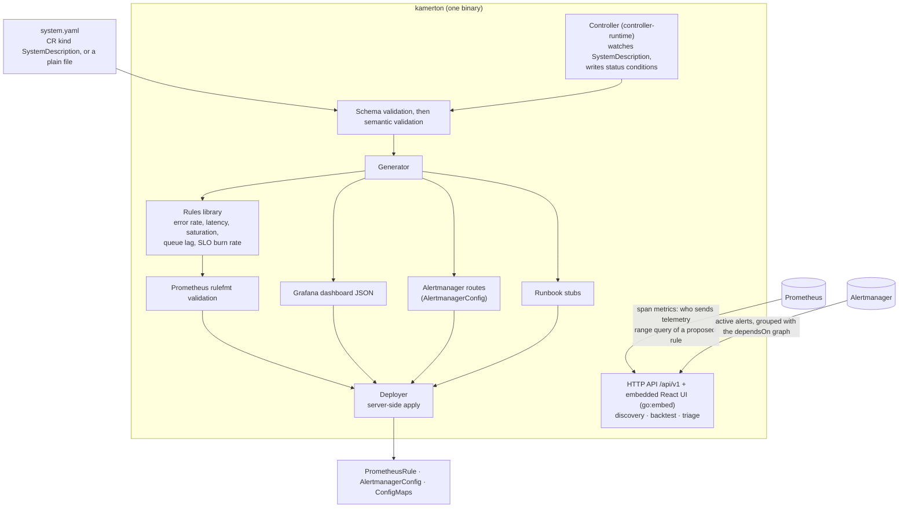

# Kamerton architecture

Kamerton orchestrates an existing open-source observability stack. It does not
replace or fork any of it. It turns one short *system description* into
configuration for those programs and keeps that configuration in sync.

Installed alongside as pinned Helm dependencies: OpenTelemetry Collector,
Prometheus Operator and Prometheus, Alertmanager, Grafana, Loki, Tempo.

## Single source of truth

- **YAML is the source of truth.** The UI is an editor over it (canvas, rule
  cards and YAML mode, all editing the same text).
- **Go types are the source of the schema.** `api/v1alpha1` → `controller-gen`
  → CRD (`deploy/helm/kamerton/crds/`) → `hack/schemagen` → JSON Schema
  (`internal/schema/systemdescription.schema.json`, embedded in the binary).
  The same schema validates descriptions in the core, and gives the YAML editor completion and hover
  (CodeMirror 6 YAML mode: completion and hover from the schema, Russian hints from `web/src/i18n/schema-ru.ts`). `make generate` regenerates everything; a unit test fails if
  the embedded schema is stale.

## Packages

| Package | Responsibility | State |
|---|---|---|
| `api/v1alpha1` | Description types (CRD + file form) | real |
| `internal/schema` | CRD → JSON Schema conversion, schema validation | real |
| `internal/description` | Load, validate (schema + semantic), defaults for metric names | real |
| `internal/rules` | Rule templates; rendering and validation with Prometheus' `rulefmt`; rules without team thresholds (`normal.go`: OOMKilled, near the limit, CPU/latency far above the previous hour) | real |
| `internal/generator` | Description → rules, dashboard, Alertmanager config, runbooks | real (dashboard minimal) |
| `internal/deployer` | Bundle → Kubernetes objects (extra labels of the system's set on PrometheusRule / AlertmanagerConfig); server-side apply | real (runs on a k3s cluster); objects carry an owner reference to their SystemDescription, so deleting a system removes them, but an object a system stops generating is not pruned while the system exists |
| `internal/controller` | Reconciler, status conditions; puts the labels of the system's set on its objects; a change of the sets ConfigMap re-reconciles every system | real (tested with fake client) |
| `internal/discovery` | Services from span metrics | real (needs Prometheus) |
| `internal/backtest` | Firing episodes of a rule over history | real (needs Prometheus) |
| `internal/triage` | Probable source on the dependency graph | graph walk real; trace/log enrichment TODO |
| `internal/clients/*` | Prometheus (official client), Alertmanager v2 | real |
| `internal/stack` | Sets of programs: the built-in set from the flags (addresses can be overridden and reset), sets added in the UI with extra labels for PrometheusRule / AlertmanagerConfig; stored in the ConfigMap `kamerton-stacks` (cluster), `.kamerton-stacks.json` next to the descriptions (local) or memory. Identity checks of an address per program (health path + build info / status). Discovery through the Kubernetes API: Services in all namespaces recognised by labels, operator service names and typical ports, confirmed over HTTP (bounded concurrency, short timeouts); Prometheus Operator `Prometheus`/`Alertmanager` resources → selector labels and warnings when instances cannot be told apart | real (unit-tested with a fake Kubernetes client and fake HTTP servers; used on a k3s cluster with a second Prometheus) |
| `internal/descstore` | Systems: SystemDescription resources (cluster) or files (local); list, create, save, update, delete | real (tested through the API in both modes) |
| `internal/telegram` | Bot API client, token Secret, chat state ConfigMap, chat discovery (leader-only polling), test messages, routing into the description | real (tested with a fake Bot API) |
| `internal/email` | Mail server settings (password in a Secret, the rest in a ConfigMap), named recipients, SMTP check and test emails, keeps managed `email-<id>` receivers in every system in sync | real (tested with a fake sender and a tiny SMTP server) |
| `internal/server` | HTTP API and SPA serving; optional login (one shared user from `KAMERTON_AUTH_USER`/`KAMERTON_AUTH_PASSWORD`, HMAC-signed 12 h session cookie, in-memory login rate limit, `X-Requested-With` required on state-changing requests; no roles, needs HTTPS at the ingress) | real |
| `web/` | React UI, embedded via `web/embed.go`: systems, canvas, rules, YAML mode, channels | real |

## Rule design notes

- Metric and label names come from `spec.telemetry`; defaults follow the
  OpenTelemetry span metrics connector and cAdvisor, nothing is tied to a demo.
- Error-rate and latency rules carry a **minimum-traffic** condition so a single
  failure in an idle service does not page.
- Error rate can be evaluated **per operation** (`perOperation: true`) and
  operations can have their own thresholds; operations with their own policy
  are excluded from the aggregated per-operation rule.
- `excludeOperations` removes noisy spans (e.g. streaming endpoints).
- `rateWindow` defaults to 5m; a warning is raised below 2m because span
  metrics are typically flushed once a minute.
- Saturation rules use `max by (namespace, pod)` because cAdvisor exports a
  pod-level series next to per-container ones.
- SLO burn-rate alerts follow the multiwindow, multi-burn-rate scheme of the
  Google SRE workbook; factors are derived from the SLO window.
- **Requests stopped arriving** (`trafficDrop`, alert `KamertonRequestsStopped`):
  a service nobody can reach has no error spans, it just stops receiving calls.
  The rule compares the current rate of incoming calls (server/consumer spans,
  `rateWindow`) with the service's normal rate: the average of 10-minute rates
  over the last day, taken only where data exists (gaps such as a sleeping
  machine neither lower nor remove it), summed over all series of the service
  (a collector restart re-creates every series under a new
  `collector_instance_id`), and existing only with at least an hour of
  history. An absent series counts as zero. It fires at or below `threshold`
  (default 10%) of normal when normal is above `minRequestsPerSecond` (default
  0.02/s, about one call a minute: quieter services go minutes without a call),
  for `for` (default 2m). It stays silent while fewer than half of the
  system's services seen in the last day have data now or one window ago:
  then the telemetry pipeline has stopped or is restarting, not the service.
  On by default for critical http/grpc services only; queues and databases
  have no incoming spans of their own and get it only when set on the service.
  The value is calls per minute, the notification adds the normal rate.
  Expression semantics are tested with Prometheus' engine (`promqltest`) on
  synthetic series for each failure mode (`internal/rules/traffic_test.go`).
- Every generated rule file is parsed with Prometheus' own `rulefmt` before it
  leaves the generator.

## Sets of programs

A system reads Prometheus and Alertmanager through the clients of its set
(`spec.stack`, empty = the built-in set; an unknown ID falls back to the
built-in set with a warning): service discovery, backtest, rule states,
active alerts and triage, the alert counts of the system list. The
all-systems alerts endpoint asks every Alertmanager used by some system and
merges duplicates. Clients are cached per address; the install-time address
uses the client built from the flags. On the write side the set's
`ruleLabels` / `alertmanagerConfigLabels` go on the system's PrometheusRule /
AlertmanagerConfig (Kamerton's own labels always win); the controller
watches only the sets ConfigMap (the manager's ConfigMap cache is limited to
it) and re-reconciles every system on a change. Two Operator-managed
instances that both select every object cannot be separated by labels; the
status page says so.

## Systems

One SystemDescription (cluster) or one YAML file (local, `--description a.yaml,b.yaml`
or a directory) is one **system**. The store (`internal/descstore`) lists, creates,
saves and deletes them; a system's ID is its name, or `name~namespace` when two
descriptions in different namespaces share a name. Telegram bots and chats are shared
by all systems; receivers and routes are per system.

## UI model

YAML is the stored truth of a system. The UI keeps a draft text and the last
description that parsed (`web/src/lib/model`): the canvas, the rule editors and the
"where alerts go" panel turn the description into pictures and write their changes
back into the YAML document node by node (comments and formatting of untouched parts
survive). While the text does not parse, the canvas shows the last valid version and
is read-only. Node positions live in the annotation `kamerton.dev/layout`
(metadata, not spec: they change nothing that is generated, survive restarts, and a
description without them is arranged automatically). Saving from the UI keeps
`kamerton.dev/*` annotations on the resource and leaves other metadata alone.

## API

| Method | Path | Notes |
|---|---|---|
| GET | `/healthz`, `/api/v1/health` | liveness |
| GET | `/api/auth/session` | whether login is on and whether this request has a session |
| POST | `/api/auth/login`, `/api/auth/logout` | `{username, password}` → session cookie; logout clears it |
| GET | `/api/v1/version` | build info |
| GET | `/api/v1/schema` | JSON Schema of the description |
| GET | `/api/v1/systems` | systems with services, rules, receivers, active alerts and state |
| POST | `/api/v1/systems` | YAML body → new system; 409 `exists` |
| GET/PUT/DELETE | `/api/v1/systems/{id}` | read (YAML, validity), save (name must not change), delete |
| POST | `/api/v1/systems/{id}/validate` | draft YAML → `{valid, errors, warnings}` |
| POST | `/api/v1/systems/{id}/rules/preview` | draft YAML (or empty: stored) → rule file |
| GET | `/api/v1/systems/{id}/rules/state` | current rule states from Prometheus `ALERTS` |
| GET | `/api/v1/systems/{id}/discovery` | services in telemetry; `described` for this system, `inSystems` for others |
| POST | `/api/v1/systems/{id}/backtest` | `{yaml, service, alert, operation, range}` (a rule of a draft) or `{expr, for, range}` |
| GET | `/api/v1/systems/{id}/runbooks/{service}` | runbook of a service |
| GET | `/api/v1/systems/{id}/alerts` | active alerts of the system |
| GET | `/api/v1/systems/{id}/telegram`, PUT `…/telegram/routing` | Telegram status / routing for this system |
| GET | `/api/v1/stack` | health of the programs of one set (`?set=`, default the built-in one) |
| GET | `/api/v1/stacks` | sets with programs (address, origin `bundled`/`own`/`none`), health and version, systems using each, warnings; discovery availability |
| POST | `/api/v1/stacks` | `{id?, name, urls: {kind: url}, ruleLabels, alertmanagerConfigLabels}` → new set; ID derived from the name when empty |
| PUT/DELETE | `/api/v1/stacks/{id}` | rename / change labels (fields present are changed); delete (409 `in_use` with the systems, 409 `builtin`) |
| PUT/DELETE | `/api/v1/stacks/{id}/programs/{kind}` | `{url}` sets an address (http/https only, no credentials); DELETE resets the built-in set's address to the install-time value or disconnects it in another set |
| POST | `/api/v1/stacks/check` | `{kind, url}` → `{state: ok, not_ready, no_answer, wrong_program, no_access, bad_url; version, message}`; only GETs go to the address |
| GET | `/api/v1/stacks/discover` | programs found in the cluster (`kind, namespace, service, url, version, healthy, state, operator, usedBy`), operator resources, warnings; `{available: false, reason}` outside a cluster |
| GET | `/api/v1/alerts` | active alerts of all systems from every Alertmanager in use (merged by fingerprint), with plain-words title, value, threshold and probable source |
| GET | `/api/v1/settings` | external URL (links on/off), storage mode, namespace, Telegram availability |
| GET | `/api/v1/runbooks/{service}` | runbook found by service name (`?system=` to choose); behind `runbook_url` of rules |
| GET/PUT | `/api/v1/description` | single-description API of earlier versions: the default system |
| POST | `/api/v1/description/validate`, `/api/v1/rules/preview`, `/api/v1/backtest` | stateless helpers |
| GET | `/api/v1/discovery/services` | discovery relative to the default system |
| GET | `/api/v1/telegram` | bot, polling health, chats with routing (`?system=`) and the systems using each chat |
| PUT | `/api/v1/telegram/token` | `{token}` → getMe → Secret; returns only the bot's public name |
| DELETE | `/api/v1/telegram/token` | removes receivers using it (in every system), the token, and discovered chats |
| POST | `/api/v1/telegram/chats` | `{chatID}`: check a chat by ID (getChat) and remember it |
| DELETE | `/api/v1/telegram/chats/{id}` | removes the chat's receivers (in every system) and forgets it |
| POST | `/api/v1/telegram/chats/{id}/test` | sends a test message; `{ok, error, migratedTo}` |
| GET | `/api/v1/email` | mail server (never the password), recipients and the systems using each |
| PUT | `/api/v1/email/server` | `{smarthost, from, username, password}` → SMTP login check → Secret; empty password keeps the stored one; updates managed receivers |
| DELETE | `/api/v1/email/server` | removes recipients' receivers (in every system), the password, settings and recipients |
| POST | `/api/v1/email/recipients` | `{name, to[]}`: remember a recipient |
| PUT | `/api/v1/email/recipients/{id}` | change name/addresses; updates the addresses in every system |
| DELETE | `/api/v1/email/recipients/{id}` | removes its receivers (in every system) and forgets it |
| POST | `/api/v1/email/recipients/{id}/test` | sends a test email; `{ok, error}` |
| PUT | `/api/v1/telegram/routing` | `{chats:[…]}` → receivers and routes in the default system (`?system=` to choose) |

## Secrets

Credentials never appear in the description, the chart values or the
repository. Telegram tokens and SMTP passwords are referenced as Secret keys and
copied by reference into `AlertmanagerConfig`. The Grafana admin password is
generated by the Grafana chart into its own Secret.

Alertmanager sends the value of a referenced Secret to the receiver's endpoint
(the SMTP password goes to `smarthost`), so a description saved through the
HTTP API may reference a Secret only when:

- a Telegram receiver names Kamerton's own token Secret, in Kamerton's namespace;
- an email receiver names Kamerton's own SMTP Secret together with the mail
  server and login configured in Kamerton (another `smarthost` is refused);
- the stored version of the same system already had that exact reference (for
  email: with the same `smarthost` and login), which keeps descriptions applied
  with kubectl by a cluster admin editable in the UI.

Anything else is refused with 400 `secret_not_allowed`; the validate and preview
endpoints report the same error. The API creates descriptions only in
Kamerton's namespace (or the single watched one; 400 `namespace_not_allowed`).
`runbookURL` and `--external-url` must be absolute http(s) URLs.

The Telegram token entered in the UI is written by the core into the Secret
`kamerton-telegram` (key `bot-token`) in Kamerton's namespace, the same name a
hand-written description references. The core reads it with direct GETs (an
uncached client), so RBAC grants get/update/patch/delete on that one Secret by
name plus `create` on Secrets in the namespace (Kubernetes cannot restrict
`create` by name) and no list/watch. The token is sent only to the Bot API;
transport errors (which embed the request URL) are scrubbed before they reach
logs or responses.

## Telegram chat discovery

The Bot API has no "list my chats" call. The core long-polls `getUpdates`
with `allowed_updates = [my_chat_member, message, channel_post]` (requested
explicitly because Telegram remembers the last setting):

- `my_chat_member`: the bot was added (member/administrator, restricted with
  `is_member`) or removed (left/kicked) → chat available or unavailable;
- `message.migrate_to_chat_id` / `migrate_from_chat_id`: a group became a
  supergroup → the stored chat and every description receiver using the old
  ID move to the new ID; getChat/sendMessage errors carrying
  `parameters.migrate_to_chat_id` are handled the same way;
- any other message or channel post reveals the chat (and title changes).

Only the leader polls (the polling loop is a controller-runtime runnable that
needs leader election; the chart requires leader election for more than one
replica), because a bot allows one `getUpdates` consumer and none while a
webhook is set; a 409 from Telegram is shown in the UI. State (bot name,
offset, chats, poll health) lives in the ConfigMap `kamerton-telegram-state`
in Kamerton's namespace: it survives restarts, is shared by replicas (any
replica serves the UI), needs no volume, and holds nothing secret. Updates
older than 24 hours are gone, so chats joined before polling started are
checked by ID (getChat) from the UI, and chats referenced by the description
are probed once per bot.

## Notifications

A rule may carry the team's own notification text (`message: {title, text,
action}` on the policy the rule comes from, `memoryMessage`/`cpuMessage`/
`restartsMessage` on saturation, `message` on custom rules), in any language.
Placeholders are a fixed list: `{value}`, `{threshold}`, `{service}`,
`{operation}`, `{system}`, `{since}`; other braces and any markup are rejected
by validation. The generator fills the first five into the annotations
`kamerton_message_title|text|action` (as Prometheus templates); `{since}` is
filled by the Alertmanager template (`reReplaceAll`). Values are escaped by
Alertmanager (html/template for Telegram and email HTML). A message about one
alert shows title, value, text and the "👉" action; a grouped message lists
only title and value per alert.

Telegram and email receivers use Kamerton's own templates
(`internal/generator/message.go`) instead of Alertmanager's defaults:
state, severity, system/environment, per alert the service, a plain-words
title, the current value and threshold, and the start time; grouped alerts
are listed compactly (at most 8, then a count). Times are written in
`spec.notifications.timeZone` (IANA name, default UTC) with the offset as label,
"09:18 16.11 UTC+5". Kamerton resolves the zone with Go's time-zone database
(embedded in the binary) and writes fixed offsets into the template, switching
at daylight-saving changes it computes for a year back and three years ahead;
the template only calls `time.Time.Add`. Alertmanager's own `tz` function
(v0.27+) is not used: it fails for names missing from the image's zoneinfo
(the v0.35.0 image ships Debian's canonical names only, no `Asia/Calcutta` or
`Europe/Kiev`) and a failing function drops the whole notification. The words come from rule
annotations `kamerton_title`, `kamerton_value`, `kamerton_threshold`, written
by the rule library in `spec.notifications.language` (en by default, ru),
next to the English `summary`/`description`. Alertmanager executes the
Telegram message (parse mode HTML) and the email HTML with html/template, so
values are escaped. Links go only to the external URL (`/alerts?...` and
`/runbooks/<service>/<alert>` in the UI); without it there are no links.
